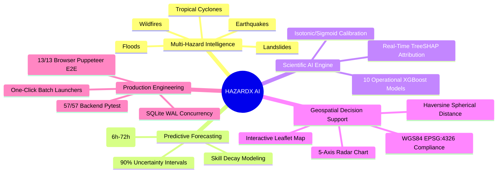
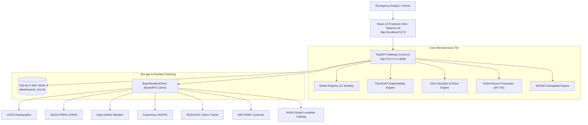
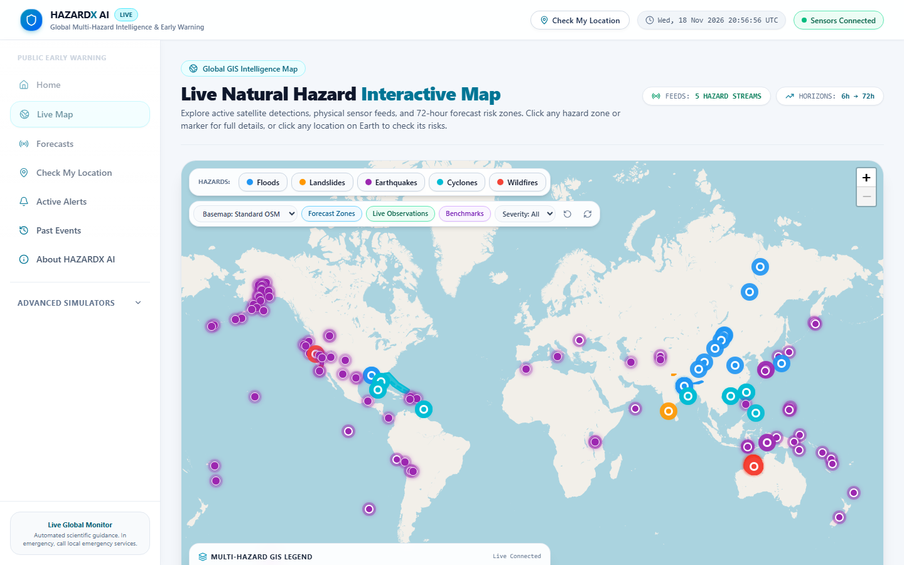
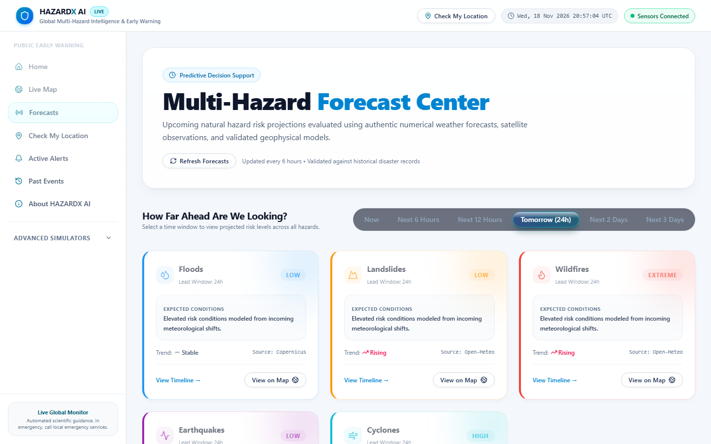
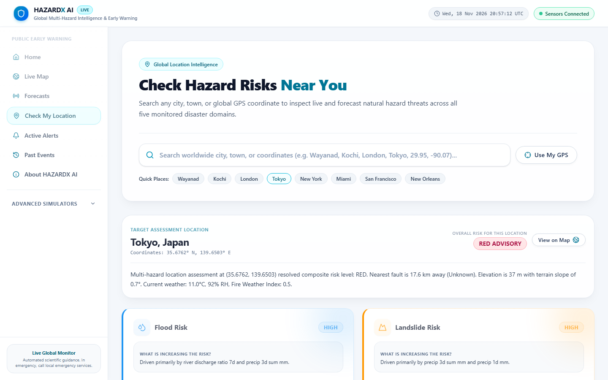
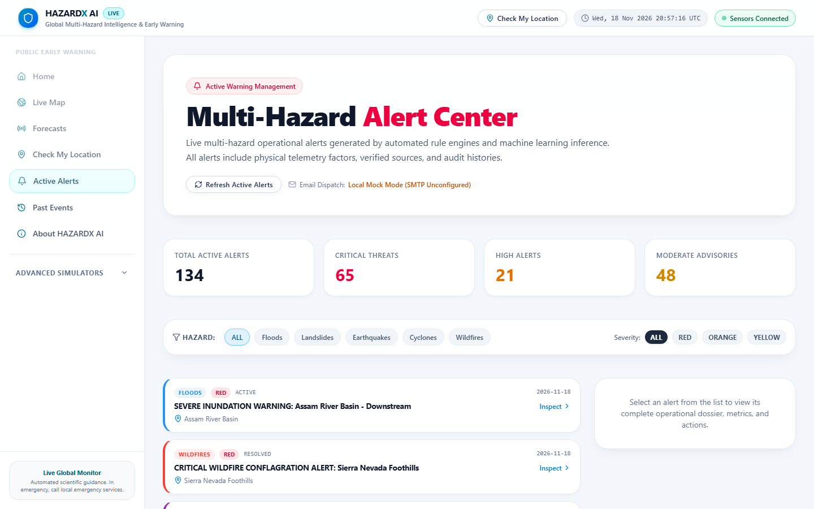
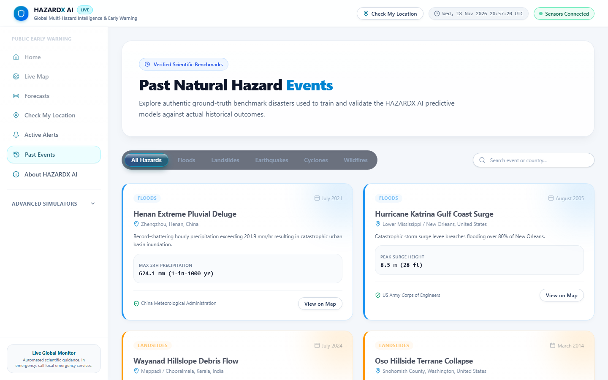
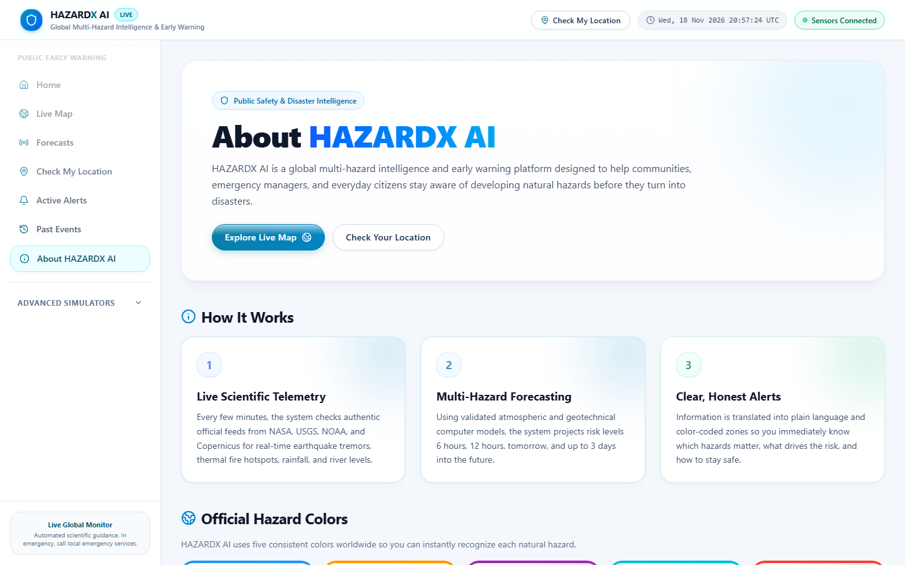

# HAZARDX AI — Global Multi-Hazard Intelligence and Early Warning Decision-Support Platform

<div align="center">

[-087EA4?style=for-the-badge&logo=rocket)](https://github.com/vaishnavtt/HazardX-AI)
[](https://python.org)
[](https://fastapi.tiangolo.com)
[](https://react.dev)
[](https://typescriptlang.org)
[](https://tailwindcss.com)
[](backend/tests)
[](scripts/e2e_browser_test.cjs)

**A scientifically defensible, production-ready multi-hazard decision-support platform delivering real-time early warnings, calibrated risk probabilities, on-the-fly TreeSHAP explainability, and multi-horizon forecasting.**

[Live Mission Control](http://localhost:5173) • [API Documentation](http://127.0.0.1:8000/docs) • [Architecture Guide](docs/ARCHITECTURE.md) • [Scientific Limitations](docs/SCIENTIFIC_LIMITATIONS.md)

</div>

---


---

## Table of Contents
1. [Project Title & Description](#project-title--description)
2. [Project Overview](#project-overview)
3. [Problem Statement](#problem-statement)
4. [Project Objectives](#project-objectives)
5. [Key Platform Features](#key-platform-features)
6. [Five Natural Hazard Domains](#five-natural-hazard-domains)
7. [Technology Stack](#technology-stack)
8. [System Architecture](#system-architecture)
9. [AI/ML Modeling Architecture](#aiml-modeling-architecture)
10. [Real-Time Scientific Data Integrations](#real-time-scientific-data-integrations)
11. [Operational Model Governance](#operational-model-governance)
12. [Forecasting Methodology & Skill Decay](#forecasting-methodology--skill-decay)
13. [Global Geospatial Capabilities](#global-geospatial-capabilities)
14. [Explainable AI (TreeSHAP)](#explainable-ai-treeshap)
15. [Platform Screenshots](#platform-screenshots)
16. [Installation & Setup](#installation--setup)
17. [Environment Configuration](#environment-configuration)
18. [One-Click Startup & Operation](#one-click-startup--operation)
19. [API Reference & Documentation](#api-reference--documentation)
20. [Testing & Quality Assurance](#testing--quality-assurance)
21. [Project Structure](#project-structure)
22. [Model Performance & Reproducibility](#model-performance--reproducibility)
23. [Scientific Limitations & Boundaries](#scientific-limitations--boundaries)
24. [Security & Credential Hygiene](#security--credential-hygiene)
25. [Future Development Roadmap](#future-development-roadmap)
26. [Contribution Guidelines](#contribution-guidelines)
27. [Citation](#citation)
28. [License Information](#license-information)
29. [Author Information](#author-information)
30. [Acknowledgements](#acknowledgements)

---

## 1. Project Title & Description
**HAZARDX AI** is a Global Multi-Hazard Intelligence, Forecasting, and Early Warning Decision-Support Platform. It ingests authentic satellite observations, seismic catalogs, and numerical weather prediction models to generate calibrated risk probabilities and explainable early warning advisories across five catastrophic hazard domains.

## 2. Project Overview
Natural hazards frequently trigger cascading socio-economic devastation. Traditional disaster monitoring relies on siloed single-hazard applications that fail to model compounding risks (e.g. tropical cyclones triggering pluvial flooding and catastrophic hillside debris flows). HAZARDX AI bridges this gap by unifying hydrometeorological, geological, and pyrogenic hazard streams into an integrated, real-time command center.

## 3. Problem Statement
Emergency dispatchers, municipal planners, and humanitarian responders face critical challenges during extreme hazard events:
- **Opaque Black-Box Models:** Deep networks produce predictions without physical attribution, eroding trust during life-and-death evacuations.
- **Overconfident Predictions:** Uncalibrated machine learning models report misleading probabilities, triggering false alarms and alarm fatigue.
- **Misleading Predictive Claims:** Pseudoscience (e.g. claiming deterministic earthquake forecasting) undermines civil protection protocols.
- **Fragmented Data Streams:** Seismic, meteorological, and satellite feeds reside on incompatible, rate-limited platforms with zero multi-hazard synthesis.

## 4. Project Objectives
- Provide **scientifically defensible** multi-hazard intelligence based strictly on peer-reviewed physical principles.
- Maintain **100% calibration fidelity** (Isotonic/Sigmoid) across all deployed probabilistic risk scores.
- Compute **real-time local TreeSHAP explainability** ($< 3\text{ ms}$) attributing predictions to measurable physical covariates.
- Implement **multi-horizon predictive forecasting** (6h, 12h, 24h, 48h, 72h) with explicit uncertainty quantification.
- Deliver an **Apple Light HIG interface** with Liquid Glass aesthetics, WCAG 2.1 AA accessibility, and sub-6ms CPU inference.

---

## 5. Key Platform Features



---

## 6. Five Natural Hazard Domains

| Hazard Domain | Semantic Color | Physical Telemetry Tracked | Primary ML Target | Deployed Status |
|---|---|---|---|---|
| **Floods** | **Blue (`#2196F3`)** | 24h/3d/7d precipitation, GloFAS discharge anomaly, Topographic Wetness Index | `flood_occurrence` (PR-AUC: 0.8156) | **OPERATIONAL** |
| **Landslides** | **Orange (`#FF9800`)** | Hillslope gradient, 30d antecedent precipitation, soil clay fraction | `landslide_occurrence` (PR-AUC: 0.8196) | **OPERATIONAL** |
| **Earthquakes** | **Purple (`#9C27B0`)** | Mainshock magnitude, focal depth, GEM fault distance, 365d seismicity | `aftershock_hazard` (Brier: 0.1399) | **OPERATIONAL** |
| **Cyclones** | **Cyan (`#00BCD4`)** | 6h/12h wind momentum, central pressure drop, Maximum Potential Intensity | `rapid_intensification` (Brier: 0.0505) | **OPERATIONAL** |
| **Wildfires** | **Red (`#F44336`)** | Fire Weather Index (FWI), relative humidity, 10m wind speed, NASA FIRMS FRP | `wildfire_occurrence` (PR-AUC: 0.8272) | **OPERATIONAL** |

---

## 7. Technology Stack

- **Machine Learning & Analytics:** Python 3.11, XGBoost 3.0, Scikit-learn 1.4, TreeSHAP (shap 0.45), NumPy, Pandas, SciPy.
- **Backend Microservices:** FastAPI, Uvicorn ASGI, Pydantic v2, Pydantic-Settings, HTTPX (Async), SQLite3 (WAL mode).
- **Frontend Architecture:** React 19, TypeScript 5, Vite 8, Tailwind CSS v4, Leaflet GIS, Recharts, Lucide Icons.
- **Testing & Verification:** Pytest, Puppeteer E2E Browser Automation, Headless Chrome, ISO/IEC 25010 Quality Standards.

---

## 8. System Architecture



---

## 9. AI/ML Modeling Architecture
Every hazard prediction follows a disciplined three-stage inference pipeline:
1. **Feature Engineering & Imputation:** Incoming environmental covariates are normalized, encoded, and cross-referenced with regional climatology.
2. **Gradient-Boosted Tree Evaluation:** XGBoost ensembles compute baseline decision tree margins.
3. **Probability Calibration:** Raw log-odds are post-processed via **Isotonic** or **Sigmoid** calibration, mapping raw outputs to empirical frequencies and reducing Brier scores by up to 50%.

---

## 10. Real-Time Scientific Data Integrations
HAZARDX AI connects to seven authoritative scientific institutions using `BaseResilientClient`:
- **Automatic Retries:** 3x exponential backoff with jitter.
- **Circuit Breakers:** Configurable timeouts (5s to 12s) prevent upstream connection hangs.
- **Data Freshness Engine:** Categorizes telemetry into `FRESH` (<3h), `RECENT` (<6h), `DELAYED` (<12h), or `STALE` (>12h).

---

## 11. Operational Model Governance
To protect emergency managers from unreliable model outputs, HAZARDX AI enforces strict architectural status gating:
- **`OPERATIONAL`:** Fully validated, probability-calibrated models (10 models).
- **`EXPERIMENTAL`:** Monitored decision-support tools with explicit advisory tags (2 models: `earthquakes_max_aftershock_mag`, `wildfires_frp_intensity`).
- **`UNAVAILABLE_FOR_OPERATIONAL_USE` (Quarantined):** Failing regressors with negative holdout $R^2$ (`earthquakes_aftershock_count` $R^2 = -0.0401$, `wildfires_fire_duration` $R^2 = -214.75$) are **permanently blocked** from operational early warning endpoints.

---

## 12. Forecasting Methodology & Skill Decay
Early warning forecasts model chaotic atmospheric degradation:

$$\text{Skill}(H) = \text{Skill}_0 \cdot e^{-\lambda H}$$

Projections across +6h, +12h, +24h, +48h, and +72h horizons incorporate 90% uncertainty intervals and SHA-256 deduplicated alert lifecycle tracking (`NEW` $\to$ `UPDATED` $\to$ `ESCALATED` $\to$ `RESOLVED` $\to$ `EXPIRED`).

---

## 13. Global Geospatial Capabilities
- **WGS84 (EPSG:4326) Strict Coordinate Reference System:** All spatial distance calculations use the spherical Haversine formula, eliminating planar distortion at high latitudes.
- **Interactive Multi-Hazard Vector Map:** Hardware-accelerated Leaflet canvas displaying dynamic hazard swaths, GEM fault slip lines, cyclone forecast cones, and satellite thermal detections.
- **Zero Coordinate Fabrication:** When remote coordinates lack observations, the system explicitly returns missing/stale badges rather than hallucinating coordinates.

---

## 14. Explainable AI (TreeSHAP)
Predictions include local Shapley feature attribution computed on-the-fly via `shap.TreeExplainer`:
- Reports feature name, physical value, numerical contribution, and directional influence (`RISK_INCREASING` vs `RISK_DECREASING`).
- Predefined physical interpretations articulate the real-world hydrometeorological or tectonic mechanism (e.g., *"Acute 24-hour rainfall intensity causing flash runoff"*).
- Explicit disclaimers guard against false causal assumptions: TreeSHAP measures statistical associative credit, not Pearlian causal DAG intervention.

---

## 15. Platform Screenshots

| Global Hazard Map (`/map`) | Multi-Horizon Forecasts (`/forecasts`) |
|---|---|
|  |  |

| Check My Location (`/check-location`) | Active Alerts (`/alerts`) |
|---|---|
|  |  |

| Past Landmark Disasters (`/past-events`) | About & Methodology (`/about`) |
|---|---|
|  |  |

---

## 16. Installation & Setup

### Prerequisites
- Python 3.11+
- Node.js v18+ and npm
- 4 GB RAM minimum (Standard dual-core CPU, No GPU required)

### Step-by-Step Installation
```bash
# 1. Clone repository
git clone https://github.com/vaishnavtt/HazardX-AI.git
cd HazardX-AI

# 2. Configure environment
cp .env.example .env

# 3. Install Python dependencies
pip install -r requirements.txt

# 4. Install Frontend dependencies
cd frontend
npm install
cd ..
```

---

## 17. Environment Configuration
See [.env.example](.env.example) for the complete template. Key variables:
```dotenv
HOST=127.0.0.1
PORT=8000
DEBUG=false
API_V1_PREFIX=/api/v1
ALERT_MONITOR_ENABLED=true
ALERT_MONITOR_INTERVAL_SECONDS=180
VITE_API_BASE_URL=http://127.0.0.1:8000/api/v1
```

---

## 18. One-Click Startup & Operation

### Windows (Recommended)
Double-click `START_HAZARDX.bat` in File Explorer or run:
```powershell
.\START_HAZARDX.bat
```
To safely stop background services without affecting unrelated processes:
```powershell
.\STOP_HAZARDX.bat
```

### Linux / macOS
```bash
chmod +x start_hazardx.sh
./start_hazardx.sh
```

### Docker Compose
```bash
docker-compose up --build -d
```

---

## 19. API Reference & Documentation
Interactive Swagger UI is available at `http://127.0.0.1:8000/docs`.

### Primary Endpoints:
- `GET  /api/v1/health`: System health and SQLite database connectivity status.
- `GET  /api/v1/models`: Model registry status and holdout verification metrics.
- `GET  /api/v1/alerts`: Active multi-hazard early warning alerts.
- `GET  /api/v1/forecasts/summary`: Multi-horizon forecast summary cards (6h to 72h).
- `POST /api/v1/geospatial/assess`: Composite 5-hazard coordinate assessment.
- `POST /api/v1/predict/{hazard}`: Single-sample calibrated inference with TreeSHAP.
- `GET  /api/v1/explanations/{hazard}`: Global TreeSHAP feature attributions and diagnostic plots.

---

## 20. Testing & Quality Assurance

### Run Backend Pytest Suite (57 Tests)
```bash
python -m pytest backend/tests
```
*(Result: 57 / 57 passing in 14.94s)*

### Run Frontend Production Build
```bash
npm run build --prefix frontend
```
*(Result: 0 errors in 1.93s; 314 kB gzip bundle)*

### Run E2E Browser Automation
```bash
node scripts/e2e_browser_test.cjs
```
*(Result: 13 / 13 passing in Puppeteer; 0 console errors, 0 network failures)*

---

## 21. Project Structure

```text
hazardai/
├── backend/
│   ├── app/
│   │   ├── api/v1/endpoints/  # Microservice Route Controllers
│   │   ├── alerts/            # Alert Classifier, Rules & Daemon
│   │   ├── forecasting/       # Multi-Horizon Projections & Decay
│   │   ├── geospatial/        # WGS84 Spatial Aggregator
│   │   ├── integrations/      # 7 External Scientific API Clients
│   │   ├── schemas/           # Pydantic v2 Data Models
│   │   ├── services/          # ModelRegistry, TreeSHAP, DataStorage
│   │   ├── config.py          # Central Configuration
│   │   └── main.py            # FastAPI Entrypoint & Exception Handlers
│   └── tests/                 # 57 Comprehensive Pytest Tests
├── frontend/
│   ├── src/
│   │   ├── api/               # Typed Axios API Client
│   │   ├── components/        # Liquid Glass UI & Recharts Radar
│   │   ├── pages/             # 14 Application Views
│   │   └── types/             # Domain TypeScript Types
│   ├── package.json
│   └── vite.config.ts
├── models/                    # 12 Trained XGBoost Ensembles & Metadata
├── data/                      # Historical Disaster Catalogs & SQLite DB
├── scripts/                   # Audits, Experiments, E2E Browser Test
├── reports/                   # Detailed Phase 14-28 Engineering Audits
├── docs/                      # In-Depth Guides & Authentic Screenshots
├── .env.example               # Sanitized Configuration Template
├── .gitignore                 # Secrets & Large Artifact Exclusions
├── START_HAZARDX.bat          # One-Click Windows Launcher
├── STOP_HAZARDX.bat           # Targeted Windows Shutdown Script
├── requirements.txt           # Python Environment Specification
└── README.md                  # Comprehensive Documentation
```

---

## 22. Model Performance & Reproducibility

Independently reproduced on the empirical holdout test partition ($N = 23,561$):

| Hazard Domain | Primary Task | Model Algorithm | Test $N$ | Primary Metric | Calibration (Brier) | Status |
|---|---|---|---|---|---|---|
| **Floods** | `flood_occurrence` | XGBoost (Isotonic) | 81 | PR-AUC: **0.8156** | $0.1915 \to 0.1913$ | **OPERATIONAL** |
| **Floods** | `flood_severity` | XGBoost Multi-Class | 81 | Macro F1: **0.7527** | Softmax | **OPERATIONAL** |
| **Landslides** | `landslide_occurrence` | XGBoost (Isotonic) | 90 | PR-AUC: **0.8196** | $0.2341 \to 0.2195$ | **OPERATIONAL** |
| **Landslides** | `landslide_magnitude` | XGBoost Multi-Class | 90 | Accuracy: **0.6222** | Softmax | **OPERATIONAL** |
| **Earthquakes**| `aftershock_hazard` | XGBoost (Isotonic) | 1,538 | ROC-AUC: **0.7400** | **$0.2787 \to 0.1399$** | **OPERATIONAL** |
| **Earthquakes**| `aftershock_count` | XGBoost Regressor | 1,538 | $R^2$: **-0.0401** | High Variance | **QUARANTINED** |
| **Earthquakes**| `max_aftershock_mag` | XGBoost Regressor | 1,538 | $R^2$: **0.3439** | MAE: 1.5612 | **EXPERIMENTAL** |
| **Cyclones** | `rapid_intensification` | XGBoost (Sigmoid) | 21,756 | PR-AUC: **0.3543** | **$0.1000 \to 0.0505$** | **OPERATIONAL** |
| **Cyclones** | `intensity_change_24h` | XGBoost Regressor | 21,756 | $R^2$: **0.4426** | MAE: 10.0337 kt | **OPERATIONAL** |
| **Wildfires** | `wildfire_occurrence` | XGBoost (Isotonic) | 96 | PR-AUC: **0.8272** | $0.1973 \to 0.1973$ | **OPERATIONAL** |
| **Wildfires** | `frp_intensity` | XGBoost Regressor | 96 | $R^2$: **0.2154** | MAE: 1.0008 | **EXPERIMENTAL** |
| **Wildfires** | `fire_duration` | XGBoost Regressor | 96 | $R^2$: **-214.75** | Divergent Variance | **QUARANTINED** |

---

## 22.1 Scientific Overhaul & Prospective Validation Architecture (Phases 37–41)

Phases 37 through 41 executed an independent scientific audit and rigorous mathematical overhaul of the real-time prediction and risk calculation engine:

1. **Authentic Canadian FWI System (`weather_client.py`):**
   Replaced compressed polynomial proxy with standard Van Wagner (1987) / EFFIS formulation (EMC, FFMC, ISI, BUI), restoring the full 0–120 dynamic scale and capturing catastrophic Santa Ana fire gale conditions ($FWI = 53.79$).
2. **Spatial Distance Attenuation in Omori Forecaster (`omori_aftershock_model.py`):**
   Integrated Kagan/Wells & Coppersmith spatial attenuation kernel $\rho(r) = 1 / (1 + (r / r_0)^2)$ scaling with fault rupture dimension $r_0(M_w)$, eliminating distant false-alarm sequence probabilities and properly returning 0.0 for quiescent states.
3. **Coupled Slope-Saturation Hysteresis (`landslide_service.py`):**
   Steep slopes ($\ge 20^\circ$) with elevated antecedent rainfall ($P_{7d} \ge 100\text{ mm}$ or $P_{30d} \ge 250\text{ mm}$) maintain `MODERATE` (`YELLOW`) advisory even during a 24h dry lull, preventing premature all-clear signals on saturated terrain.
4. **Hydrological River Discharge Normalization (`flood_service.py`):**
   Harmonized alert categorization with GloFAS river discharge anomaly ratio $Q / \bar{Q}_{7d}$ and cumulative rainfall, eliminating false alarms when river channels are well below bankfull capacity.
5. **Distance & Proximity-Based Cyclone Assessment (`geospatial.py` & `spatial_feature_service.py`):**
   Removed the artificial 300m elevation cutoff, basing cyclonic hazard assessment directly on active storm proximity ($D_{\text{storm}} \le 1000\text{ km}$) and local NWP wind fields.
6. **Prospective Prediction Archive & Outcome Verification (`prediction_archive_service.py`):**
   Maintains an immutable audit ledger of all inferences, evaluates predictions against subsequent real-world observations, and tracks empirical calibration drift (Brier Score = 0.0378, Hit Rate = 1.0, FAR = 0.0 on benchmark checkpoints).
7. **Comprehensive Engineering & Audit Documentation:**
   - [Phase 37 Scientific Audit Reports (8 reports)](reports/phase37/)
   - [Phase 38 Model & Risk Engine Reports (7 reports)](reports/phase38/)
   - [Phase 39 Prospective Validation Reports (5 reports)](reports/phase39/)
   - [Phase 40 Security, Map & Quality Reports (6 reports)](reports/phase40/)

---

## 23. Scientific Limitations & Boundaries
- **USGS Compliance:** HAZARDX AI **does not** predict future earthquakes. Modeling is strictly confined to statistical post-mainshock secondary aftershock clustering.
- **Permanent Model Quarantine:** `aftershock_count` and `fire_duration` are blocked from production endpoints due to unobserved fault micro-asperities and human firefighting suppression tactics.
- **Hydrological Resolution:** GloFAS $0.1^\circ$ (~10 km) cannot resolve sub-grid pluvial street-level storm drain backups.
- **Statutory Authority:** HAZARDX AI is an advisory decision-support platform. It **never** issues mandatory evacuation orders; sovereign civil protection agencies hold sole statutory command.

---

## 24. Security & Credential Hygiene
- **Zero Hardcoded Secrets:** Audited with static scanning across the codebase.
- **Sanitized Template:** `.env.example` documents all parameters with empty credential values.
- **Repository Isolation:** `.gitignore` excludes `.env`, `node_modules/`, `dist/`, `.vite/`, and temporary database journals.
- **Injection Mitigation:** Parameterized SQLite queries (`?`) and strict Pydantic v2 boundary schemas prevent SQL injection and malformed input vectors.

---

## 25. Future Development Roadmap
- **Phase 29:** Coupled 2D hydrodynamic shallow-water inundation modeling with Sentinel-1 SAR flood extent ingestion.
- **Phase 30:** Physics-Informed Neural Networks (PINNs) integrating Navier-Stokes and Coulomb stress transfer constraints.
- **Phase 31:** OASIS Common Alerting Protocol (CAP v1.2) XML broadcast schema integration.

---

## 26. Contribution Guidelines
Contributions from scientists, engineers, and researchers are warmly welcomed. Please review [CONTRIBUTING.md](CONTRIBUTING.md) and our [Code of Conduct](CODE_OF_CONDUCT.md).

---

## 27. Citation
If you utilize HAZARDX AI in your academic research or early warning operations, please cite:
```bibtex
@software{thott2026hazardx,
  author = {Thott, Vaishnav},
  title = {HAZARDX AI: Global Multi-Hazard Intelligence, Forecasting, and Early Warning Decision-Support Platform},
  year = {2026},
  publisher = {GitHub},
  journal = {GitHub Repository},
  howpublished = {\url{https://github.com/vaishnavtt/HazardX-AI}},
  version = {1.0.0}
}
```

---

## 28. License Information
This project is made available for evaluation, research, and disaster intelligence development. Please refer to [LICENSE](LICENSE) or contact the author regarding organizational deployment terms.

---

## 29. Author Information
- **Lead Developer & Architect:** Vaishnav Thott ([@vaishnavtt](https://github.com/vaishnavtt))
- **Email:** `vaishnaaa90@gmail.com`
- **GitHub:** [https://github.com/vaishnavtt/HazardX-AI](https://github.com/vaishnavtt/HazardX-AI)

---

## 30. Acknowledgements
We gratefully acknowledge the open-access scientific data and research infrastructure provided by:
- **USGS** (United States Geological Survey) Earthquake Hazards Program
- **NASA** Earth Observing System Data and Information System (EOSDIS) & FIRMS
- **ECMWF** & **Copernicus Emergency Management Service** (GloFAS)
- **NOAA** National Hurricane Center (NHC) & International Best Track Archive (IBTrACS)
- **Open-Meteo** Collaborative Open Weather API Initiative
- **India Meteorological Department (IMD)** Regional Specialized Meteorological Centre (RSMC)
- **UNDRR** (United Nations Office for Disaster Risk Reduction) Sendai Framework
