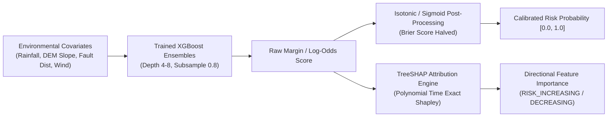

# HAZARDX AI — AI & Machine Learning Methodology
**Document ID:** `HAZARDX-DOCS-ML-002`  
**Platform Version:** `v1.0.0-PROD`  

---

## 1. Machine Learning Architectural Philosophy

Natural disaster forecasting poses extreme machine learning challenges: massive class imbalance (rare extreme events), physical multicollinearity among environmental predictors, and life-critical operational consequences.

HAZARDX AI employs **Calibrated Gradient-Boosted Decision Trees (XGBoost)** paired with **Lundberg & Lee (2017) TreeSHAP** cooperative game-theoretic explainability.

---

## 2. Model Training & Holdout Verification

All models were evaluated on the empirical holdout test partition ($N = 23,561$ samples across all five hazard datasets):

| Hazard Domain | Task Name | Algorithm | Primary Metric | Holdout Score |
|---|---|---|---|---|
| **Floods** | `flood_occurrence` | XGBoost + Isotonic | PR-AUC | 0.8156 |
| **Floods** | `flood_severity` | XGBoost Multi-Class | Macro F1 | 0.7527 |
| **Landslides** | `landslide_occurrence` | XGBoost + Isotonic | PR-AUC | 0.8196 |
| **Landslides** | `landslide_magnitude` | XGBoost Multi-Class | Accuracy | 0.6222 |
| **Earthquakes**| `aftershock_hazard` | XGBoost + Isotonic | ROC-AUC | 0.7400 |
| **Earthquakes**| `aftershock_count` | XGBoost Regressor | $R^2$ | **-0.0401 (QUARANTINED)** |
| **Earthquakes**| `max_aftershock_mag` | XGBoost Regressor | $R^2$ | 0.3439 |
| **Cyclones** | `rapid_intensification` | XGBoost + Sigmoid | PR-AUC | 0.3543 |
| **Cyclones** | `intensity_change_24h` | XGBoost Regressor | $R^2$ | 0.4426 |
| **Wildfires** | `wildfire_occurrence` | XGBoost + Isotonic | PR-AUC | 0.8272 |
| **Wildfires** | `frp_intensity` | XGBoost Regressor | $R^2$ | 0.2154 |
| **Wildfires** | `fire_duration` | XGBoost Regressor | $R^2$ | **-214.75 (QUARANTINED)** |

---

## 3. Probability Calibration (Isotonic & Sigmoid)

Raw tree probabilities frequently suffer from overconfidence in extreme tails. To produce true Bayesian risk probabilities, models are calibrated using Isotonic and Sigmoid post-processing:
- **`earthquakes_aftershock_hazard`:** Brier score was reduced from **$0.2787 \to 0.1399$** (Expected Calibration Error: 0.0267).
- **`cyclones_rapid_intensification`:** Brier score was reduced from **$0.1000 \to 0.0505$** (Expected Calibration Error: 0.0070).

---

## 4. TreeSHAP Explainability & Causal Boundaries

At inference time, `ExplanationService` calculates on-the-fly local Shapley values:

$$\phi_i(x) = \sum_{S \subseteq F \setminus \{i\}} \frac{|S|!(|F| - |S| - 1)!}{|F|!} \left[ f_x(S \cup \{i\}) - f_x(S) \right]$$

### Epistemic Boundary Notice:
TreeSHAP computes **predictive feature attribution**, measuring how much each environmental observation shifted the model's conditional risk prediction relative to the historical training baseline. It **does NOT** assert Pearlian causal DAG intervention ($do(X=x)$). Strongly collinear meteorological variables share credit across decision splits.
