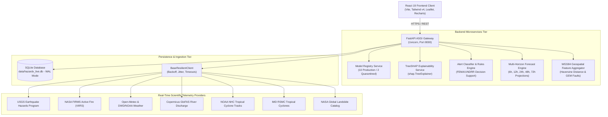

# HAZARDX AI — System Architecture Specification
**Document ID:** `HAZARDX-DOCS-ARCH-001`  
**Platform Version:** `v1.0.0-PROD`  

---

## 1. High-Level Architectural Overview

HAZARDX AI is an end-to-end multi-hazard intelligence and early warning decision-support system designed for high concurrency, low latency, and strict scientific defensibility.



---

## 2. Component Directory Architecture

```text
hazardai/
├── backend/                  # FastAPI Python Backend
│   ├── app/
│   │   ├── api/v1/          # REST Endpoints & Routers
│   │   ├── alerts/          # Alert Classifier, Rules & Monitoring
│   │   ├── forecasting/     # Multi-Horizon Forecast Engine
│   │   ├── geospatial/      # WGS84 Spatial Aggregator & Geocoding
│   │   ├── ingestion/       # Background Ingestion Scheduler
│   │   ├── integrations/    # 7 External Scientific API Clients
│   │   ├── schemas/         # Strict Pydantic v2 Models & DTOs
│   │   ├── services/        # ModelRegistry, TreeSHAP, DataStorage
│   │   └── config.py        # Central Environment Configuration
│   └── tests/               # 57 Pytest Unit & Integration Tests
│
├── frontend/                 # React 19 Client
│   ├── src/
│   │   ├── api/             # Typed Axios API Client
│   │   ├── components/      # UI, Navigation, Liquid Glass, Radar Chart
│   │   ├── pages/           # 14 Application Views
│   │   └── types/           # TypeScript Domain Definitions
│   └── package.json         # Node Dependencies & Scripts
│
├── models/                   # 12 Trained XGBoost Models & Metadata
├── data/                     # Cleaned Data Catalogs & SQLite DB
├── scripts/                  # E2E Automation, Audits, Experiments
├── reports/                  # Phase 14-28 Scientific Audit Reports
└── docs/                     # Technical Documentation & Screenshots
```

---

## 3. Core Architectural Invariants

1. **In-Memory Model Caching:** All models are loaded once on boot into a thread-safe Singleton `ModelRegistry`, ensuring single-digit millisecond inference latencies.
2. **SQLite WAL Concurrency:** Database operates in Write-Ahead Logging mode (`PRAGMA journal_mode=WAL;`), enabling simultaneous analytical reads and background telemetry writes.
3. **Resilient Asynchronous Fetching:** Upstream scientific APIs inherit from `BaseResilientClient` with automated exponential backoff, rate limit handling, and SQLite fallback caching.
