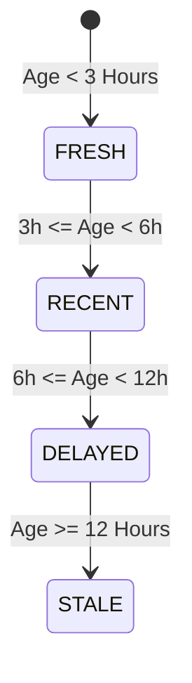

# HAZARDX AI — External Scientific Data Sources & Freshness Tiers
**Document ID:** `HAZARDX-DOCS-DS-003`  
**Platform Version:** `v1.0.0-PROD`  

---

## 1. Scientific Data Providers

HAZARDX AI ingests observational telemetry and numerical weather predictions from seven authoritative scientific institutions:

| Data Stream | Primary Provider | Integration Format | Nominal Frequency | Typical Freshness | Operational Role |
|---|---|---|---|---|---|
| **USGS Seismicity** | USGS Earthquake Hazards Program | REST GeoJSON | 5 minutes | `FRESH` (< 5m) | Real-time global earthquake feeds ($M \ge 2.5$) |
| **NASA FIRMS** | NASA EOSDIS (VIIRS / MODIS) | CSV / GeoJSON | 1 hour | `FRESH` (< 30m) | Satellite thermal radiative heat detections (FRP) |
| **Open-Meteo NWP**| Open-Meteo (DWD / NOAA / ECMWF) | REST JSON | 1 hour | `FRESH` (< 15m) | Surface precipitation, wind, temperature, humidity |
| **Copernicus GloFAS** | ECMWF / Copernicus | NetCDF / REST | 6 hours | `FRESH` (< 3h) | River discharge ($m^3/s$) and catchment anomalies |
| **NOAA NHC** | National Hurricane Center | XML / ATCF | 3 hours | `FRESH` (< 1h) | Active cyclone tracks, central pressure, wind fixes |
| **IMD RSMC** | India Meteorological Dept | Web Bulletins | 6 hours | `FRESH` / `STALE`* | North Indian Ocean tropical cyclone advisories |
| **NASA GLC** | NASA Goddard Space Flight Center | GeoJSON Catalog | Static + Ingest | `FRESH` (Baseline) | Global rainfall-triggered landslide events |

*\*Note: IMD RSMC reports `STALE` during quiet inter-monsoon periods when no tropical storms are actively being bulletined in the Arabian Sea or Bay of Bengal.*

---

## 2. Four-Tier Data Freshness Engine

Rather than displaying a misleading green "LIVE" badge whenever an HTTP 200 is received, HAZARDX AI audits the actual observation timestamp against current UTC wall-clock time:

- **`FRESH` (Green):** Telemetry observed within the last 3 hours. Real-time early warning algorithms operate with maximum skill.
- **`RECENT` (Blue):** Telemetry observed 3 to 6 hours ago. Short-range extrapolation active.
- **`DELAYED` (Amber):** Telemetry observed 6 to 12 hours ago. Warning engine applies uncertainty penalties.
- **`STALE` (Red):** Telemetry older than 12 hours. Operational alerts flagged with clear caution banners.

---

## 3. Provenance and Zero-Fabrication Invariant

If an external upstream API is temporarily offline, the system returns cached observations marked `CACHED_OBSERVATION` or displays explicit offline badges. **The platform never fabricates synthetic sensor readings or phantom disaster coordinates.**
