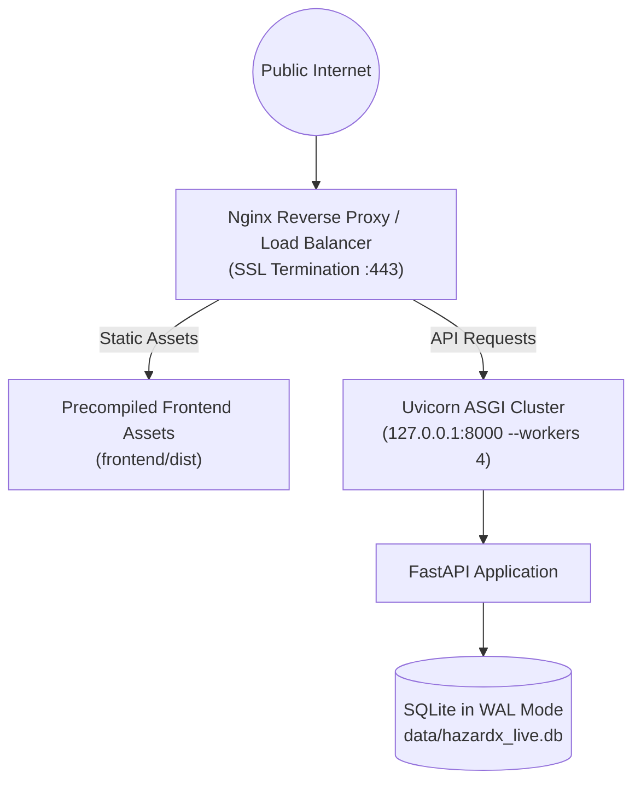

# HAZARDX AI — Production Deployment & Operations Guide
**Document ID:** `HAZARDX-DOCS-DEP-009`  
**Platform Version:** `v1.0.0-PROD`  

---

## 1. Production Deployment Topology



---

## 2. Docker Compose Production Deployment

```bash
# Clone the repository
git clone https://github.com/vaishnavtt/HazardX-AI.git
cd HazardX-AI

# Create production environment configuration
cp .env.example .env

# Launch with Docker Compose
docker-compose up --build -d

# Verify operational status
docker-compose logs -f
```

---

## 3. Production Monitoring & Uptime

- **Health Probe:** Configure orchestrators (Kubernetes, AWS ECS, Systemd) to ping `http://localhost:8000/api/v1/health` every 30s.
- **Process Memory Limits:** Bounded to $< 500$ MB RAM per worker thread.
- **Log Management:** All logs route to standard output formatted with ISO 8601 timestamps and service identifiers.
