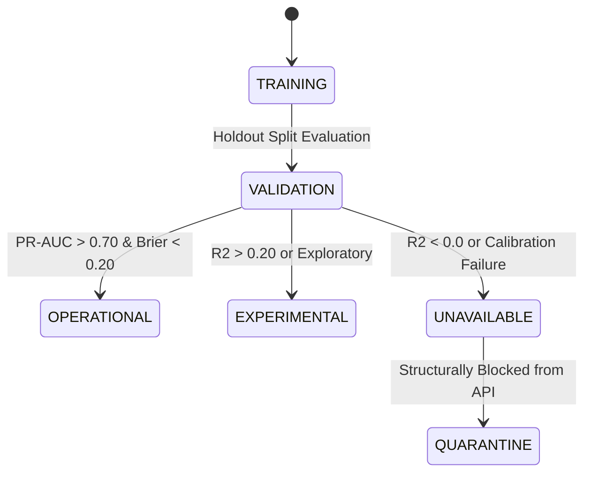

# HAZARDX AI — Operational Model Governance Framework
**Document ID:** `HAZARDX-DOCS-GOV-007`  
**Platform Version:** `v1.0.0-PROD`  

---

## 1. Governance Architecture

Machine learning models deployed in life-critical early warning must adhere to strict governance boundaries to prevent unverified, overfitting, or deteriorating models from delivering erroneous guidance to public safety analysts.

---

## 2. Operational Status Categories

1. **`OPERATIONAL` (Production Status):** Fully validated on independent holdout split ($N = 23,561$). Probability calibrated with Isotonic/Sigmoid regression. Deployed to live early warning endpoints.
   - Deployed: `floods_flood_occurrence`, `floods_flood_severity`, `landslides_landslide_occurrence`, `landslides_landslide_magnitude`, `earthquakes_aftershock_hazard`, `cyclones_rapid_intensification`, `cyclones_intensity_change_24h`, `wildfires_wildfire_occurrence`.
2. **`EXPERIMENTAL` (Decision Support with Advisory Tag):** Validated positive correlation, but subject to high variance or localized sensitivity.
   - Deployed with advisory tags: `earthquakes_max_aftershock_mag` ($R^2 = 0.3439$), `wildfires_frp_intensity` ($R^2 = 0.2154$).
3. **`UNAVAILABLE_FOR_OPERATIONAL_USE` (Quarantine):** Models that fail out-of-sample generalization ($R^2 < 0$).
   - Quarantined: `earthquakes_aftershock_count` ($R^2 = -0.0401$), `wildfires_fire_duration` ($R^2 = -214.75$).

---

## 3. Automated Gating Invariants

In `backend/app/config.py` and `backend/app/services/model_registry.py`, any request attempting to route predictions through a quarantined model automatically triggers a governance guard, returning an HTTP 403/404 with an explicit scientific disclaimer.
