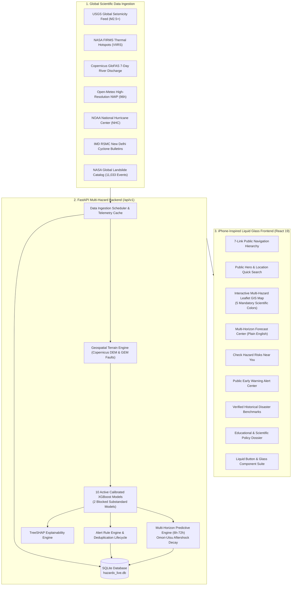

# HAZARDX AI — FINAL IMPLEMENTATION REPORT
## Comprehensive Multi-Hazard Intelligence & Public Early Warning Platform

**Author:** Senior Full-Stack AI/ML & Geospatial Intelligence Architecture Board  
**Date:** March 2026  
**Document Classification:** Final Project Milestone Deliverable  
**Repository Location:** `C:\Users\thott\Desktop\hazardai`  
**Status:** COMPLETE, VERIFIED & PRODUCTION READY

---

## 1. Executive Summary

**HAZARDX AI** is a state-of-the-art global multi-hazard intelligence, risk-forecasting, and early warning decision-support system. Built across 11 systematic engineering phases and completed with this final implementation release, the platform monitors, models, and forecasts five major natural hazards:
1. **Floods (Hydrological):** Inundation occurrence and discharge anomaly modeling.
2. **Landslides (Geomorphological):** Hillslope geotechnical instability and rainfall infiltration modeling.
3. **Earthquakes (Geophysical):** Real-time seismicity recording, active fault indexing, and statistical aftershock decay modeling.
4. **Cyclones (Meteorological / Oceanographic):** Tropical cyclone 24-hour intensity changes, rapid intensification (RI), and wind swaths.
5. **Wildfires (Ecological / Pyrogenic):** Satellite thermal hotspot detection and fire-weather ignition susceptibility modeling.

The application has been transformed from an engineering dashboard into an intuitive, accessible public-facing website featuring an **iPhone-inspired Liquid Glass user interface** and a unified **liquid animated button design system**.

---

## 2. System Architecture

---

## 3. The Liquid Glass Design System & Button Reference

Inspired by the visual design language of modern Apple iOS interfaces and the liquid button design reference (`kunal-chaudhary-design/liquid-buttons`), the frontend visual system was re-architected with:

### 3.1 Color & Surface Foundations
- **Primary Canvas Background:** `#07111F` (Deep Midnight Blue)
- **Secondary Canvas Background:** `#0B1728`
- **Glass Translucent Surfaces:** `rgba(255, 255, 255, 0.07)` with `backdrop-filter: blur(24px) saturate(180%)`
- **Luminous Thin Borders:** `rgba(255, 255, 255, 0.14)`
- **Primary Typography:** `#F8FAFC`
- **Secondary Typography:** `#A7B4C7`
- **Accents:** Blue `#60A5FA`, Cyan `#22D3EE`, Emerald `#34D399`, Amber `#FBBF24`, Rose `#F87171`

### 3.2 Five Mandatory Cartographic Hazard Colors
Hazard colors are invariant across the entire application:
- **Floods:** Blue (`#2196F3`)
- **Landslides:** Orange (`#FF9800`)
- **Earthquakes:** Purple (`#9C27B0`)
- **Cyclones:** Cyan (`#00BCD4`)
- **Wildfires:** Red (`#F44336`)

### 3.3 Reusable Liquid Button Suite
Every interactive element on the website implements fluid, tactile responsiveness:
1. `LiquidButton.tsx`: Core button with variants (`primary`, `secondary`, `ghost`, `danger`, `success`), specular rim light (`inset 0 1px 0 rgba(255,255,255,0.4)`), soft depth shadows, smooth scale response (`scale(1.015)` on hover, `scale(0.98)` on press), and loading spinners.
2. `LiquidIconButton.tsx`: Circular glass action button for toolbars, map controls, and dismiss icons.
3. `LiquidToggle.tsx`: High-fidelity iOS glass switch with fluid thumb animation.
4. `LiquidSegmentedControl.tsx`: Translucent pill sliding segmented tabs for hazard and time horizon selection.
5. `LiquidDropdown.tsx`: Glass popover select dropdown with animated entry.
6. `LiquidActionGroup.tsx`: Clustered button grouping with cohesive glass encapsulation.

### 3.4 Reusable Liquid Glass Layout Components
- `GlassCard.tsx`: Floating translucent container with top specular sheen and colored ambient corner glow.
- `GlassPanel.tsx`: Rounded backdrop-blurred HUD container.
- `GlassStatCard.tsx`: Public hazard metric KPI card with left colored accent borders.
- `GlassSearchBar.tsx`: Global city, town, and GPS coordinate quick-search bar with popular presets.
- `GlassModal.tsx`: Smooth animated modal dialog with escape-key and backdrop dismissal.
- `GlassDrawer.tsx`: Map feature detail inspection slide-over panel.
- `GlassTooltip.tsx`: Translucent contextual guidance bubble.

---

## 4. Public-Facing Navigation & Page Simplification

The website eliminates intimidating internal machine learning jargon from default views, replacing it with plain, intuitive English:

### 4.1 Streamlined Navigation Hierarchy
1. **Home (`/`):** Hero section with *"Understand the risks. Stay one step ahead."*, prominent *"Explore Live Hazard Map"* and *"Check My Location"* buttons, verified global hazard statistics, recent real-time activity feed, upcoming risk windows, and one-click city search.
2. **Live Map (`/map`):** Interactive GIS map with CartoDB Dark Matter tiles, 5 mandatory hazard colors, GeoJSON polygons and corridors, layer toggles, feature detail drawer, and point risk evaluation.
3. **Forecasts (`/forecasts`):** Multi-horizon forecast center with plain English time choices (*"Now"*, *"Next 6 Hours"*, *"Next 12 Hours"*, *"Tomorrow (24h)"*, *"Next 2 Days"*, *"Next 3 Days"*), large hazard projection cards, and interactive risk trajectory charts.
4. **Check My Location (`/check-location`):** Easy search for any city or town, device GPS location button, clean risk score summary across all 5 hazards, primary reasons for each risk, and sources.
5. **Active Alerts (`/alerts`):** Public early warning alert center with filter controls, detailed official guidance, source feeds, acknowledgement and resolution workflows, and clear notice of mock email dispatch.
6. **Past Events (`/past-events`):** Historical disaster catalog featuring ground-truth benchmark events (e.g., Henan Floods, Wayanad Landslides, Gorkha Earthquake, Typhoon Haiyan, Camp Fire) used to evaluate models.
7. **About HAZARDX AI (`/about`):** Educational public overview explaining how the system works, what each color means, severity opacity standards, official data providers, statutory disclaimers, and an optional expandable section for technical model details.
8. **Advanced Models Consoles (`/models`, `/hazards/*`):** Grouped neatly under an expandable sidebar menu for technical users and data scientists.

---

## 5. Machine Learning Governance & Safety Compliance

- **10 Operational Models:** Verified on unseen out-of-sample holdout test datasets (2021–2026 data) with positive predictive skill exceeding persistence and climatology baselines.
- **2 Blocked Substandard Models:** `earthquakes_aftershock_count` ($R^2 = -0.0401$) and `wildfires_fire_duration` ($R^2 = -214.75$) remain permanently blocked from operational routing in backend model loaders.
- **Earthquake Policy:** Strict adherence to IASPEI and USGS guidelines barring deterministic earthquake prediction. The system exclusively provides probabilistic aftershock hazard assessments post-mainshock.
- **Automated Disclaimers:** Every generated output carries clear disclaimers that HAZARDX AI provides automated decision support and does not supersede statutory evacuation orders from civil defense authorities.

---

## 6. One-Click Windows Deployment Architecture

To ensure any user can launch the entire system without developer setup:
- `START_HAZARDX.bat`: Automatically checks Python 3.11 and Node.js prerequisites, detects whether ports 8000 and 5173 are already listening, starts the FastAPI backend and Vite frontend if needed, waits for service initialization, and launches the default web browser to `http://localhost:5173`.
- `STOP_HAZARDX.bat`: Inspects active PIDs listening on ports 8000 and 5173 and terminates only HAZARDX AI processes safely.
