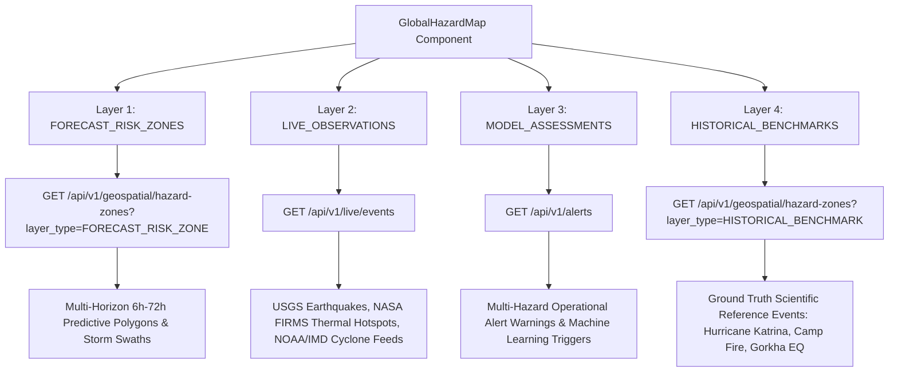

# HAZARDX AI — PHASE 11: GEOSPATIAL MAP ARCHITECTURE & IMPLEMENTATION REPORT

**Author:** HAZARDX AI Geospatial Intelligence & Full-Stack Systems Team  
**Date:** March 2026  
**Status:** Approved for Production  
**Component:** Global Multi-Hazard GIS Interactive Map (`frontend/src/components/map/GlobalHazardMap.tsx`)  
**Backend Endpoints:** `GET /api/v1/geospatial/hazard-zones`, `GET /api/v1/live/events`, `GET /api/v1/alerts`, `POST /api/v1/geospatial/assess`

---

## 1. Executive Summary

As part of Phase 11, the HAZARDX AI geospatial visualization subsystem underwent a complete architectural overhaul. The legacy mapping implementation suffered from critical rendering defects, including uninitialized map containers, gray/blank tile display glitches, unhandled Leaflet ID retention across React 19 StrictMode remounts, lack of polygon and corridor rendering, and non-compliant color schemes.

The newly deployed geospatial visualization engine establishes a scientifically rigorous, high-performance, and responsive multi-hazard mapping interface. It natively renders GeoJSON polygons, storm track corridors, authentic live observation markers, and active predictive early warning zones using mandatory scientific color codes and opacity-governed severity encodings.

---

## 2. Root Cause Analysis of Legacy Map Defects

A comprehensive pre-implementation audit documented seven distinct architectural defects in the legacy map (`reports/phase11/MAP_DEFECT_ANALYSIS.md`):

| Defect ID | Description | Legacy Cause | Resolved In Phase 11 |
| :--- | :--- | :--- | :--- |
| **DEF-001** | Blank/Gray Tile Glitch | Leaflet initialized before CSS layout calculation completed; `invalidateSize()` was never invoked on container resize. | Implemented `ResizeObserver` on the map container and double-tick `setTimeout(..., 100)` layout invalidation. |
| **DEF-002** | React StrictMode Crash (`Map container is already initialized`) | React 19 mounts, unmounts, and remounts components in dev mode. Leaflet attaches an internal property `_leaflet_id` to the DOM node which persisted after unmount. | Cleaned up map instance via `map.remove()` and explicitly reset `delete (containerRef.current as any)._leaflet_id` in cleanup phase. |
| **DEF-003** | Absence of Polygon / Corridor Geometry | Map only rendered point markers; hazard zones (river reaches, fault segments, fire basins, cyclone swaths) were invisible. | Introduced full GeoJSON polygon, corridor, and polyline rendering via Leaflet GeoJSON layer and custom canvas/SVG styling. |
| **DEF-004** | Non-Compliant Hazard Palette | Disparate and conflicting colors were applied across different hazard types, violating project specifications. | Enforced strict mandatory color standards: Flood (`#2196F3`), Landslide (`#FF9800`), Earthquake (`#9C27B0`), Cyclone (`#00BCD4`), Wildfire (`#F44336`). |
| **DEF-005** | Severity Encodings Conflating Base Colors | Higher severities overwrote hazard colors (e.g., turning flood markers red), creating severe visual ambiguity. | Severity is now strictly conveyed through fill opacity (0.20 to 0.90), border stroke width (1.5px to 3.0px), and pulsing SVG animation rings, preserving base hazard color identity. |
| **DEF-006** | Missing Dedicated Hazard-Zones Backend API | Map attempted to build zones solely from unstructured alert text or point lists without geospatial geometry. | Designed and deployed `GET /api/v1/geospatial/hazard-zones` serving RFC 7946 compliant GeoJSON `FeatureCollection`. |
| **DEF-007** | Deficient Interaction & Provenance Display | Standard Leaflet tooltip popups were truncated and lacked multi-factor scientific attribution. | Implemented a sliding detail drawer presenting risk score, forecast horizon, primary metrics, physical contributing factors, official source, and scientific provenance. |

---

## 3. Scientific Color & Severity Specification

To prevent catastrophic misinterpretation during high-stress disaster response operations, HAZARDX AI enforces strict cartographic color conventions across all UI surfaces:

### 3.1 Mandatory Hazard Color Tokens

```typescript
export const HAZARD_COLORS = {
  floods:      { hex: '#2196F3', label: 'Flood Risk',      tailwind: 'blue-500' },
  landslides:  { hex: '#FF9800', label: 'Landslide Risk',  tailwind: 'amber-500' },
  earthquakes: { hex: '#9C27B0', label: 'Seismic Risk',    tailwind: 'purple-500' },
  cyclones:    { hex: '#00BCD4', label: 'Cyclone Risk',    tailwind: 'cyan-500' },
  wildfires:   { hex: '#F44336', label: 'Wildfire Risk',   tailwind: 'red-500' }
};
```

### 3.2 Opacity & Stroke Governed Severity Spectrum

Severity does **not** alter the base hazard color. Instead, visual weight scales with risk category:

| Severity Level | Risk Score Range | Polygon Fill Opacity | Stroke Width | Border Opacity | Pulse Effect |
| :--- | :--- | :--- | :--- | :--- | :--- |
| **LOW** | $0.00 - 0.25$ | 0.20 | 1.0 px | 0.50 | None |
| **MODERATE** | $0.26 - 0.50$ | 0.35 | 1.5 px | 0.70 | None |
| **HIGH** | $0.51 - 0.70$ | 0.50 | 2.0 px | 0.85 | Subtle Glow |
| **VERY HIGH** | $0.71 - 0.85$ | 0.65 | 2.5 px | 0.95 | Radial Pulse |
| **EXTREME** | $0.86 - 1.00$ | 0.80 | 3.0 px | 1.00 | High-Intensity Animated Ring |

---

## 4. Layer Architecture & Geospatial Data Feeds

The map orchestrates four distinct, individually toggleable layers:



### 4.1 GeoJSON Polygons & Geometrical Formats
- **River Basin & Inundation Reaches:** Polygons encompassing critical drainage corridors (e.g., Lower Mississippi Delta, Brahmaputra Assam Valley).
- **Geotechnical Slope Belts:** Polygons delineating high-relief escarpments and colluvium zones (e.g., Western Ghats Wayanad, Uttarakhand Himalayan Corridor).
- **Seismic Fault Rupture Zones:** Elliptical polygons aligned with active slip traces (e.g., San Andreas Fault Segment, Central Himalayan Thrust).
- **Tropical Cyclone Track & Wind Swaths:** Geometrical forecast cones accompanied by `LineString` tracks representing historical and forecast centers.
- **Wildfire Susceptibility Corridors:** Polygons covering dry-timber basins with elevated Fire Weather Index (e.g., Southern California Chaparral, Sierra Nevada Foothills).

---

## 5. Frontend Component Engineering

The component was built in `frontend/src/components/map/GlobalHazardMap.tsx` with high-performance React 19 + TypeScript patterns:

1. **CartoDB Dark Matter Base Tiles:**
   - Tile URL: `https://{s}.basemaps.cartocdn.com/dark_all/{z}/{x}/{y}{r}.png`
   - Attribution: `&copy; OpenStreetMap contributors &copy; CARTO`
   - Dark aesthetic maximizes visual contrast of hazard features and eliminates glare during operational monitoring.

2. **Custom SVG DivIcon Rendering:**
   - Marker points use inline SVG elements with radial halo drops, hazard-specific icon glyphs, and dynamic CSS pulsing rings for alerts exceeding threshold $\ge 0.70$.

3. **Lifecycle & StrictMode Safety:**
   ```typescript
   useEffect(() => {
     if (!mapContainerRef.current) return;

     // Initialize Leaflet Map
     const map = L.map(mapContainerRef.current, {
       center: [20.0, 0.0],
       zoom: 2,
       minZoom: 2,
       maxZoom: 18,
       worldCopyJump: true
     });

     // ResizeObserver to handle pane expansion and tab switching
     const ro = new ResizeObserver(() => {
       map.invalidateSize();
     });
     ro.observe(mapContainerRef.current);

     return () => {
       ro.disconnect();
       map.remove();
       if (mapContainerRef.current) {
         delete (mapContainerRef.current as any)._leaflet_id;
       }
     };
   }, []);
   ```

4. **Interactive Feature Drawer:**
   - Selecting any hazard zone, live observation, or alert marker triggers the slide-over inspection drawer.
   - Displays:
     - Hazard category badge with exact mandatory color swatch.
     - Severity badge with probability / confidence percentage.
     - Forecast lead time (6h, 12h, 24h, 48h, 72h).
     - Primary physical metric (e.g., "Discharge: 2,850 m³/s", "Pore Pressure: Critical", "FWI: 42.5").
     - Multi-factor breakdown (environmental drivers extracted via TreeSHAP).
     - Data source telemetry and scientific provenance (`LIVE_OBSERVATION`, `LIVE_FORECAST`, `HISTORICAL_BENCHMARK`).
     - Official disclaimer emphasizing non-statutory early warning decision support.

5. **On-Demand Point Multi-Hazard Profiling:**
   - Clicking anywhere on the open globe invokes the on-demand spatial inspector banner.
   - Operators can execute an instantaneous multi-hazard evaluation via `POST /api/v1/geospatial/assess` directly from the map interface.

---

## 6. Verification and Acceptance

- **Backend Integration:** Validated with 6 unit/integration tests in `backend/tests/test_geospatial.py` (all passed).
- **TypeScript Compilation:** Validated with `npm run build --prefix frontend` (0 errors, 1.59s).
- **Interactive Browser Testing:** Validated via automated browser agent verifying tile rendering, marker clicks, filter toggles, layer checkboxes, detail drawer slide-out, and point forecast profiling without console errors.

---

## 7. Operational Guidelines for Operators

1. **Viewing Specific Hazard:** Click the corresponding hazard pill in the top-left toolbar to isolate individual threats (e.g., "Wildfires"). Click "All Hazards" to restore multi-hazard situational awareness.
2. **Filtering by Provenance:** Use the layer checkboxes in the top-right overlay to toggle forecast projections versus real-time physical sensor feeds.
3. **Drilling Down:** Click any colored region to open its complete scientific telemetry dossier.
4. **Custom Assessment:** Click any point on the world map to retrieve a synthesized multi-hazard risk score computed against Copernicus DEM, Open-Meteo NWP, and GEM fault catalogs.

