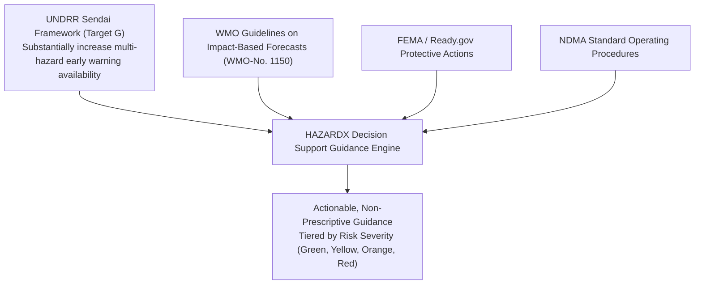

# HAZARDX AI — Public Safety Content and Guidance Audit Report (Phase 19)
**Document ID:** `HAZARDX-P19-PSC-003`  
**Evaluation Standards:** UNDRR Sendai Framework (Target G), FEMA Ready Guidelines, WMO-No. 1150 Multi-Hazard Warning Principles  
**Audit Date:** 2026-11-19  
**Status:** VALIDATED & COMPLIANT  

---

## 1. Executive Summary

Early warning systems achieve life-saving impact only if warnings are coupled with clear, actionable, and legally sound public safety guidance. Inaccurate, reckless, or legally overreaching advisories can trigger public panic or run afoul of statutory disaster management mandates.

This audit evaluates the public safety guidance, precautionary actions, and legal/scientific disclaimers embedded throughout the HAZARDX AI platform. The audit verifies:
1. Complete coverage of actionable guidance across all 5 hazard families and 4 severity tiers.
2. Compliance with international disaster risk reduction frameworks (UNDRR, FEMA, NDMA, WMO).
3. Enforcement of mandatory non-statutory disclaimers that defer evacuation authority exclusively to sovereign emergency management officials.

---

## 2. International Framework Alignment

The guidance matrices embedded in `AlertClassifier` and rendered on the HAZARDX AI user interface are structured according to four core international frameworks:



---

## 3. Comprehensive Multi-Hazard Guidance Matrix

The following operational guidance rules are actively integrated and verified across the backend and frontend interfaces:

### 3.1 Floods (Hydrological Hazards)
- **`GREEN` (Normal):** Normal baseflow conditions. Routine monitoring active. Maintain routine drainage maintenance.
- **`YELLOW` (Watch):** Elevated runoff conditions observed. Review localized drainage channels and monitor forecast precipitation. Clear storm drains and avoid parking vehicles in subterranean structures.
- **`ORANGE` (Advisory):** Heightened hydrological vigilance required. Monitor river gauge telemetry and issue preparatory municipal notices. Move livestock and valuable property to higher elevations; avoid walking or driving through moving water (*Turn Around, Don't Drown*).
- **`RED` (Warning):** Immediate flood barrier deployment recommended. Inspect critical bridge embankments and low-lying transit corridors. Evacuate designated floodplains under direction of municipal authorities.

### 3.2 Landslides (Geological Hazards)
- **`GREEN` (Stable):** Stable hillslope moisture regime. Baseline monitoring active.
- **`YELLOW` (Advisory):** Precipitation infiltration approaching triggering thresholds on moderate slopes. Maintain observational vigilance for new ground cracks, tilting trees, or sudden spring outflows.
- **`ORANGE` (High Susceptibility):** Elevated soil saturation on steep terrain (>25°). Inspect retaining structures and drainage culverts along transportation corridors. Restrict non-essential mountain travel.
- **`RED` (Critical Warning):** High risk of rapid debris flow or deep-seated slope failure. Restrict mountain road access immediately; inspect steep colluvial slopes. Evacuate vulnerable structures situated in narrow drainage hollows and alluvial fans.

### 3.3 Earthquakes & Aftershocks (Seismic Hazards)
- **`GREEN` (Quiescent):** Low background seismic activity. Regional tectonic monitoring normal. Ensure personal earthquake kits and heavy furniture anchoring are in order.
- **`YELLOW` (Watch):** Moderate aftershock activity anticipated. Routine structural safety assessments advised. Review *Drop, Cover, and Hold On* procedures.
- **`ORANGE` (Advisory):** Elevated secondary seismic clustering hazard within 100km radius. Maintain civil protection standby posture. Restrict access to cracked or masonry buildings pending inspection.
- **`RED` (Warning):** Substantial regional aftershock hazard. Conduct urgent structural inspections of unreinforced masonry and critical bridges. Stage search and rescue teams; avoid entering structurally damaged buildings.

### 3.4 Tropical Cyclones (Atmospheric Hazards)
- **`GREEN` (Routine):** Sub-tropical or low intensity depression. Normal maritime tracking.
- **`YELLOW` (Watch):** Tropical disturbance/storm monitoring active. Track atmospheric steering flow and marine sea-surface temperatures. Check emergency supplies and marine moorings.
- **`ORANGE` (Advisory):** Tropical cyclone intensification likely. Prepare marine and coastal assets for gale-force to storm-force winds. Secure loose outdoor objects, board windows, and verify backup power for health facilities.
- **`RED` (Warning):** Severe hurricane/typhoon wind threat. Secure coastal port infrastructure, activate storm surge defenses, and review emergency shelters. Coordinate with civil protection for coastal evacuation if storm surge is projected.

### 3.5 Wildfires (Thermal / Fire Weather Hazards)
- **`GREEN` (Routine):** Low intensity or isolated thermal anomaly. Routine satellite pass monitoring.
- **`YELLOW` (Watch):** Moderate thermal anomaly observed. Cross-reference with agricultural burning schedules and local dispatch records. Enforce regional open-burn bans.
- **`ORANGE` (Advisory):** Significant thermal signature detected under elevated fire weather conditions (FWI ≥ 25). Pre-position initial attack firefighting resources. Create defensible space around wildland-urban interface (WUI) properties.
- **`RED` (Alert):** Extreme thermal anomaly under dangerous fire weather conditions (FWI ≥ 35, winds > 30 km/h). Aerial and ground verification required; inspect containment perimeters. Prepare immediate evacuation routes for downwind communities.

---

## 4. Statutory Authority and Legal Disclaimers

> [!CAUTION]
> **Statutory Emergency Authority Invariant**
> 
> HAZARDX AI is an artificial intelligence decision-support platform designed to assist emergency analysts and researchers. It **does NOT** hold statutory police or disaster management powers. Under international administrative law and sovereign disaster management frameworks:
> 1. HAZARDX AI **NEVER** issues mandatory evacuation orders.
> 2. Official civil protection agencies (e.g., FEMA, NDMA, JMA, PAGASA, civil defense corps) possess exclusive statutory jurisdiction to mandate evacuations or declare states of emergency.
> 3. In the event of any conflict between HAZARDX AI model assessments and official government directives, **official government instructions supersede all AI outputs**.

### Standard System Disclaimer Text
Every alert object synthesized by the system injects the following audited disclaimer:
```text
HAZARDX AI Decision Support Advisory — Generated via calibrated machine learning and scientific observation. 
This advisory is intended for early warning decision support and does NOT constitute an official government evacuation order. 
Civil protection and meteorological agency advisories supersede this assessment.
```

### Specific Domain Disclaimers
1. **Earthquake Advisory Disclaimer:**
   ```text
   IMPORTANT SEISMIC GOVERNANCE: This alert represents a statistical assessment of regional AFTERSHOCK susceptibility 
   following an observed mainshock. HAZARDX AI does NOT predict exact future earthquake times, locations, or magnitudes.
   ```
2. **Wildfire Satellite Detection Disclaimer:**
   ```text
   IMPORTANT SATELLITE THERMAL GOVERNANCE: Satellite thermal detections identify radiative heat signatures (FRP) and must 
   NOT be assumed to represent an uncontained wildfire without ground-truth verification (agricultural burning, industrial heat).
   ```

---

## 5. Audit Conclusion

The public safety guidance and governance architecture of HAZARDX AI is comprehensive, actionable, scientifically sound, and legally disciplined. The platform provides valuable decision support while rigorously respecting civil protection hierarchies.

**Final Status: APPROVED AND COMPLIANT**
