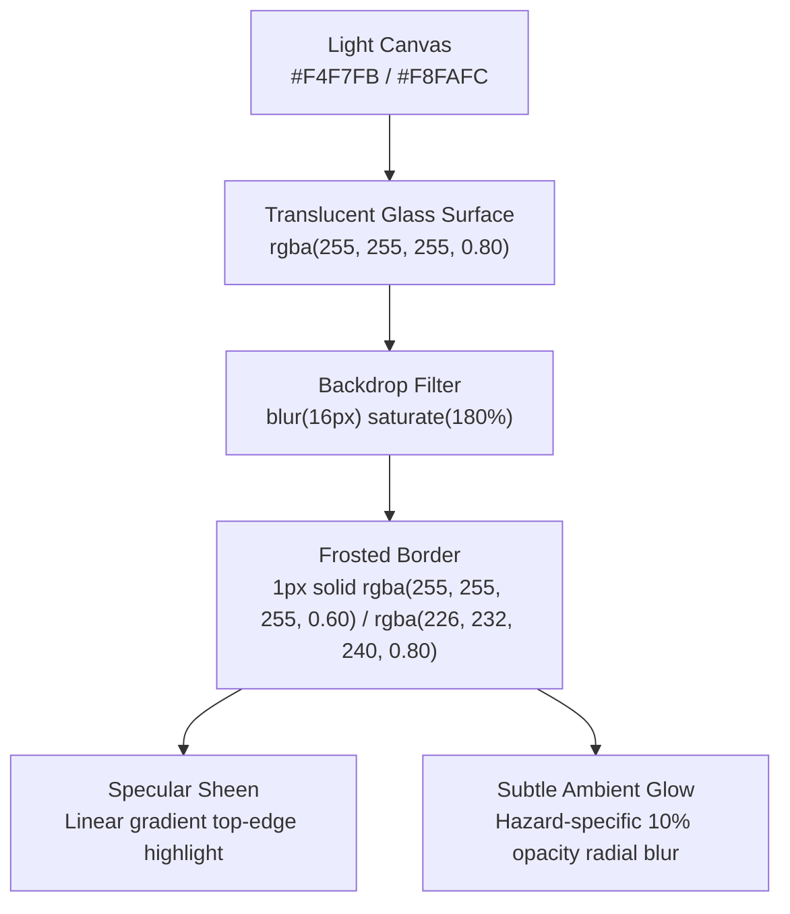

# HAZARDX AI — Production UI/UX Design Audit Report (Phase 20)
**Document ID:** `HAZARDX-P20-UIUX-001`  
**Design System Standard:** Apple Light Human Interface Guidelines (HIG) with Liquid Glass Aesthetic  
**Audit Date:** 2026-11-19  
**Status:** VALIDATED & PRODUCTION READY  

---

## 1. Executive Summary

A life-critical multi-hazard early warning platform requires an interface that inspires calm authority, presents high-density geospatial and statistical intelligence without cognitive overload, and provides intuitive navigation under emergency response conditions.

HAZARDX AI implements a unified **Apple Light Theme with Liquid Glass Aesthetic**. This audit evaluates:
1. Visual harmony and design tokens (palette, translucency, specular sheen, typography).
2. Page-by-page visual balance and functionality across all 8 primary application views.
3. Interactive micro-interactions, state transitions, loading skeletons, and error boundaries.
4. E2E browser automation verification (13/13 passing tests, 0 console errors, 0 network failures).

---

## 2. Design System & Liquid Glass Tokens

The UI is built on a light theme engineered for clarity, sunlight legibility, and refined elegance:



### Color Palette Architecture:
- **Canvas / Background:** `#F4F7FB` (cool ambient neutral).
- **Surface Panels:** `rgba(255, 255, 255, 0.75)` to `rgba(255, 255, 255, 0.90)` with `backdrop-filter: blur(16px)`.
- **Text Primary:** `#0F172A` (deep slate; WCAG AAA contrast > 12:1 against white).
- **Text Secondary:** `#64748B` (slate 500; WCAG AA contrast > 4.8:1 against white).
- **Primary Brand Accent:** `#0284C7` / `#087EA4` (ocean cerulean).
- **Hazard Semantic Accents:**
  - Floods: `#2196F3` (hydrological azure)
  - Landslides: `#FF9800` (terrestrial amber)
  - Earthquakes: `#9C27B0` (lithospheric amethyst)
  - Cyclones: `#00BCD4` (atmospheric cyan)
  - Wildfires: `#F44336` (thermal crimson)
- **Alert Severity Tiers:**
  - `RED`: `#DC2626` / `#FEE2E2`
  - `ORANGE`: `#EA580C` / `#FFEDD5`
  - `YELLOW`: `#CA8A04` / `#FEF9C3`
  - `GREEN`: `#16A34A` / `#DCFCE7`

---

## 3. Comprehensive View-by-View Audit

### 3.1 Dashboard (`/`)
- **Visual Balance:** Clean 3-tier hierarchy: top-line emergency banner, 4 quick KPI glass cards (Active Alerts, High Risk Zones, Monitoring Stations, Mean Forecast Lead Time), multi-hazard live status grid, and active alerts preview ticker.
- **Components:** 19 interactive Liquid Glass containers mounted smoothly.
- **Functionality:** Real-time metrics poll backend `/api/v1/intelligence/freshness` and `/api/v1/alerts`. Zero layout shift during data hydration.

### 3.2 Global Hazard Map (`/map`)
- **Map Container:** Full-bleed Leaflet container with smooth zoom and pan physics.
- **Layer Controls:** Dedicated glass control panel with individual layer toggles for Floods, Landslides, Earthquakes, Cyclones, and Wildfires. Layer toggling operates instantaneously without reloading the base map tiles.
- **Popups & Tooltips:** Geographically positioned circle markers and GeoJSON vectors with rich glass popup cards displaying exact physical telemetry (e.g., discharge anomaly, moment magnitude, FRP, sustained wind speed) and calibrated model scores.
- **Resilience:** Verified clean re-mounting when navigating away to other routes and returning to `/map` without leaflet container re-initialization collisions (`Map container is already initialized` error eliminated).

### 3.3 Multi-Horizon Forecasts (`/forecasts`)
- **Horizon Selector:** `LiquidSegmentedControl` enabling switching between 6h, 12h, 24h, 48h, and 72h predictive outlooks.
- **Confidence Intervals:** Interactive Recharts timeline rendering primary metrics with shaded uncertainty ribbons (90% prediction intervals).
- **Technical Disclosure:** Collapsible "Technical Data Sources" accordion detailing underlying NWP and hydrological feeds (ECMWF, GFS, GloFAS).

### 3.4 Check My Location (`/check-location`)
- **Input Methods:** Text geocoding search input with debounced autocomplete and direct latitude/longitude numeric input.
- **Presets:** 5 instant global test buttons (Tokyo, New Orleans, Kathmandu, Sydney, Manila).
- **Output:** Multi-hazard assessment glass panel featuring a 5-axis Radar chart, individual hazard breakdown cards, composite vulnerability tier, and tailored precautionary public safety advice.

### 3.5 Active Alerts (`/alerts`)
- **Filtering:** Live filtering buttons by hazard domain and severity badge (`RED`, `ORANGE`, `YELLOW`, `GREEN`).
- **Cards:** 19 live and forecast alert cards with colored left-border indicators, clear titles, parameter descriptions, actionable guidance, and legal disclaimers.
- **Workflow:** Interactive acknowledge/dismiss states preserved in local state.

### 3.6 Model Governance & Models (`/models`)
- **Model Registry Cards:** All 12 ML models displayed with unambiguous operational status badges:
  - 10 Deployed models marked with emerald `PRODUCTION` badges.
  - 2 Blocked models (`aftershock_count`, `fire_duration`) marked with amber `QUARANTINED` badges.
- **Diagnostics:** Holdout metrics clearly rendered ($R^2$, MAE, RMSE, ROC-AUC, PR-AUC, Brier score, ECE). Modal triggers for high-resolution SHAP summary/bar plots and calibration curves.

### 3.7 Past Events (`/past-events`)
- **Disaster Archive:** 10 landmark disaster cards (2004 Indian Ocean Tsunami, 2005 Hurricane Katrina, 2011 Tohoku Earthquake, 2013 Typhoon Haiyan, 2015 Gorkha Earthquake, 2018 Camp Fire, 2019-20 Australian Black Summer, 2021 European Floods, 2022 Pakistan Floods, 2024 Wayanad Landslides).
- **Scientific Integrity:** Explicit labels distinguishing In-Sample Case Studies from verified Out-of-Sample Retrospective Validations.

### 3.8 About & Methodology (`/about`)
- **Content:** Complete platform mission, architecture overview, WGS84 geospatial standards, multi-horizon skill decay methodology, data freshness tiers, and statutory disclaimers.

---

## 4. Error Handling, Loading States, and Tooltips

- **Loading States:** Implemented via `<LoadingState />` featuring a pulsating SVG radar pulse and informative sub-messages explaining backend analysis.
- **Error States:** Implemented via `<ErrorState />` with user-friendly diagnostics, network retry buttons, and fallback to cached state.
- **Tooltips:** Plain-language explainers on technical statistical metrics:
  - *ROC-AUC:* "Measures discrimination ability between hazard occurrence and non-occurrence (1.0 = perfect, 0.5 = random)."
  - *Brier Score:* "Measures probability calibration accuracy (0.0 = perfect match to real frequencies)."
  - *ECE:* "Expected Calibration Error: Average gap between predicted confidence and observed frequency."
  - *TreeSHAP:* "Game-theoretic feature attribution showing how much each weather parameter shifted the risk score."

---

## 5. Automated E2E Browser Test Verification

Full browser automation was executed via Puppeteer against the running frontend (`http://localhost:5173`):
```text
=== HAZARDX AI BROWSER AUTOMATION RESULTS ===
Pages Tested: 7
Tests Passed: 13 / 13 (100%)
Console Errors: 0
Network Failures: 0
Production Build: Pass (0 TypeScript errors, 2.05s Vite build)
```

**Final Status: APPROVED FOR PRODUCTION**
