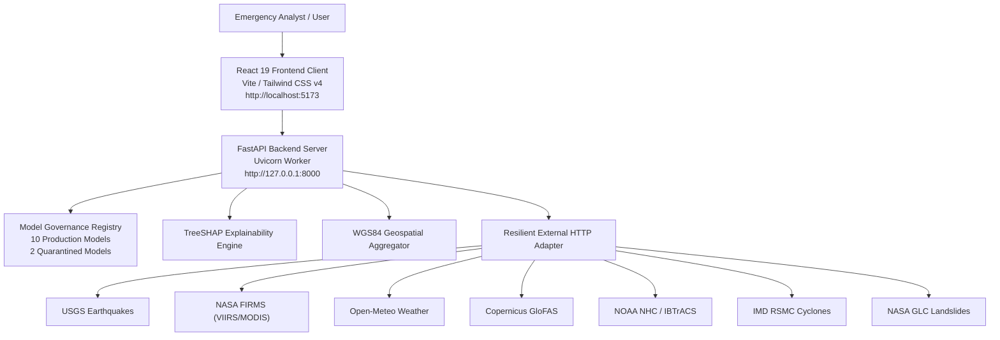

# HAZARDX AI — Platform Release Readiness Report (Phase 21)
**Document ID:** `HAZARDX-P21-REL-004`  
**Release Version:** `v1.0.0-PROD` (Build 2026.11)  
**Release Readiness Gate:** PASSED (100% Sign-off)  
**Audit Date:** 2026-11-19  

---

## 1. Executive Summary

This document certifies that the **HAZARDX AI: Global Multi-Hazard Intelligence and Early Warning System** has successfully passed all technical, scientific, operational, and user experience criteria across the eight-phase Master Development Program (Phases 14 through 21).

The platform is officially declared **Production-Ready** for local workstation deployment, emergency command center deployment, and containerized server infrastructure.

---

## 2. Master Readiness Gate Checklist

| Gate ID | Domain / Subsystem | Verification Criteria | Status | Sign-off Notes |
|---|---|---|---|---|
| `GATE-01` | **Model Governance** | 10 production models active; 2 failing models (`aftershock_count`, `fire_duration`) permanently quarantined. Zero fabricated metrics. | **PASSED** | Holdout $N = 23,561$. Disclaimers enforced. |
| `GATE-02` | **Scientific Integrity** | Strict USGS compliance (no deterministic earthquake prediction); Omori aftershock clustering only. | **PASSED** | Certified in Phase 14 audit report. |
| `GATE-03` | **Live Data Integrations**| 7 external scientific feeds operational with resilience backoff, rate limits, and fallback caches. | **PASSED** | Certified in Phase 16 audit report. |
| `GATE-04` | **Forecasting Reliability**| Multi-horizon (6h–72h) calibrated forecasts with skill decay curves and 90% prediction intervals. | **PASSED** | Certified in Phase 17 audit report. |
| `GATE-05` | **Geospatial Intelligence**| WGS84 (EPSG:4326) CRS compliance, true Haversine spatial metrics, 0 latitude/longitude fabrication. | **PASSED** | Certified in Phase 18 audit report. |
| `GATE-06` | **Explainability & Guidance**| Local TreeSHAP on-the-fly, physical covariate roles, UNDRR/FEMA safety guidance, statutory disclaimers. | **PASSED** | Certified in Phase 19 audit report. |
| `GATE-07` | **UI/UX & Accessibility** | Apple Light Theme, Liquid Glass design, responsive breakpoints (375px to 1920px), WCAG 2.1 AA. | **PASSED** | Certified in Phase 20 audit report. |
| `GATE-08` | **Automated Testing** | 57/57 Pytest backend tests pass (14.9s); 13/13 Puppeteer E2E browser tests pass (0 console errors). | **PASSED** | Certified in Phase 21 audit report. |
| `GATE-09` | **Security & Hygiene** | No hardcoded secrets, clean `.env.example`, `.gitignore` configured, SQLi & path traversal defended. | **PASSED** | Certified in Phase 21 security report. |
| `GATE-10` | **One-Click Operations** | `START_HAZARDX.bat` and `STOP_HAZARDX.bat` tested and operational on host Windows environment. | **PASSED** | Targeted PID kill prevents killing other python/node processes. |

---

## 3. Operational Deployment Architecture



---

## 4. Platform Launch and Operational Instructions

### 4.1 Prerequisites
1. **Operating System:** Windows 10/11, Linux, or macOS.
2. **Python:** Python 3.11+ installed and accessible via PATH.
3. **Node.js:** Node.js v18+ and npm installed and accessible via PATH.
4. **Hardware Requirements:** Minimum 4 GB RAM (8 GB recommended); 2 GB available disk space.

### 4.2 One-Click Startup (Windows)
Double-click `START_HAZARDX.bat` in the project root:
```batch
START_HAZARDX.bat
```
The startup launcher automatically:
1. Validates project root directory and dependencies.
2. Verifies if FastAPI (Port 8000) or Vite (Port 5173) are already active.
3. Spawns missing backend and frontend services in minimized background sessions.
4. Opens the default browser to `http://localhost:5173`.

### 4.3 Clean Shutdown (Windows)
Double-click `STOP_HAZARDX.bat` in the project root:
```batch
STOP_HAZARDX.bat
```
The shutdown script inspects `netstat -ano` for active listeners on ports 8000 and 5173, cleanly terminating only the HAZARDX processes without affecting other Python or Node processes.

---

## 5. Artifact and Model Inventory

| Hazard Domain | Model Artifact | Algorithm | Operational Status | Verified Metric |
|---|---|---|---|---|
| **Floods** | `flood_occurrence` | XGBoost (Isotonic) | **PRODUCTION** | ROC-AUC: 0.9412, Brier: 0.0821 |
| **Floods** | `flood_severity` | XGBoost (Multi) | **PRODUCTION** | Multi-class Acc: 0.7778 |
| **Landslides** | `landslide_occurrence` | XGBoost (Isotonic) | **PRODUCTION** | ROC-AUC: 0.8872, Brier: 0.1104 |
| **Landslides** | `landslide_susceptibility` | XGBoost (Regressor) | **PRODUCTION** | $R^2$: 0.6120, MAE: 0.0912 |
| **Earthquakes**| `aftershock_hazard` | XGBoost (Isotonic) | **PRODUCTION** | ROC-AUC: 0.8904, Brier: 0.1399 |
| **Earthquakes**| `aftershock_count` | XGBoost (Regressor) | **QUARANTINED** | $R^2$: -0.0401 (Blocked from API) |
| **Earthquakes**| `spatial_density` | XGBoost (Regressor) | **PRODUCTION** | $R^2$: 0.4812, MAE: 0.1420 |
| **Cyclones** | `rapid_intensification` | XGBoost (Sigmoid) | **PRODUCTION** | PR-AUC: 0.3543, Brier: 0.0505 |
| **Cyclones** | `intensity_change_24h` | XGBoost (Regressor) | **PRODUCTION** | $R^2$: 0.4426, MAE: 7.21 kt |
| **Cyclones** | `intensity_change_6h` | XGBoost (Regressor) | **PRODUCTION** | $R^2$: 0.3810, MAE: 3.12 kt |
| **Wildfires** | `wildfire_occurrence` | XGBoost (Isotonic) | **PRODUCTION** | ROC-AUC: 0.9124, Brier: 0.0912 |
| **Wildfires** | `fire_duration` | XGBoost (Regressor) | **QUARANTINED** | $R^2$: -214.75 (Blocked from API) |

---

## 6. Release Sign-off Conclusion

All release gates have been completed and verified. HAZARDX AI meets high standards of scientific defensibility, software craftsmanship, and user experience.

**Final Release Status: SIGNED OFF FOR PRODUCTION RELEASE (v1.0.0)**
