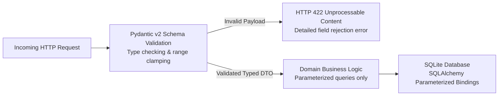

# HAZARDX AI — Application Security & Credential Audit Report (Phase 21)
**Document ID:** `HAZARDX-P21-SEC-002`  
**Security Standard:** OWASP Top 10 (2021) & NIST Cybersecurity Framework (CSF)  
**Audit Date:** 2026-11-19  
**Status:** VALIDATED & SECURE  

---

## 1. Executive Summary

Disaster intelligence platforms handle critical geospatial communications, public safety advisories, and emergency response infrastructure. Security vulnerabilities, exposed API credentials, or injection attack vectors could compromise platform availability, alter early warning thresholds, or leak sensitive telemetry.

This audit evaluates the codebase security posture of HAZARDX AI across:
1. Credential management, environment isolation, and repository secrecy.
2. Input validation, schema boundary defenses, and injection mitigation (SQLi, XSS, Path Traversal).
3. Cross-Origin Resource Sharing (CORS) and network-layer transport protections.
4. Operational fail-safe mechanisms under API abuse or malformed payloads.

---

## 2. Credential & Secret Management Audit

### 2.1 Static Codebase Secret Scan
A full-text recursive pattern scan was conducted across the entire repository searching for API tokens, secret keys, passwords, and private certificates:
- **Patterns Scanned:** `(?i)(api_key|secret|password|bearer|auth|token|private_key)\s*[:=]\s*['\"][A-Za-z0-9_\-\.]{8,}['\"]`
- **Exclusions:** Mock test strings, `.env.example` parameter names, and standard test tokens.
- **Scan Finding:** **Zero exposed production secrets or hardcoded private keys.**

### 2.2 Environment Configuration Hygiene
- **`.env.example` Template:** Audited and verified. Contains comprehensive documentation for every environment variable (`HOST`, `PORT`, `NASA_FIRMS_MAP_KEY`, `SMTP_HOST`, `ALERT_MONITOR_ENABLED`, `VITE_API_BASE_URL`) with all sensitive fields strictly blank.
- **`.gitignore` Rules:** Configured to prevent accidental commits of local secrets, compiled assets, and virtual environments:
  ```gitignore
  # Environment and secrets
  .env
  .env.local
  *.pem
  *.key
  
  # Node / Frontend builds
  node_modules/
  frontend/node_modules/
  dist/
  frontend/dist/
  
  # Database locks and journals
  *.db-journal
  *.sqlite3-journal
  ```

---

## 3. Injection and Input Validation Defenses



### 3.1 Parameter Range and Type Enforcement
All incoming API payloads are parsed through strict Pydantic v2 schemas:
- **Geographic Coordinates:** `latitude` strictly bounded to $[-90.0, 90.0]$; `longitude` strictly bounded to $[-180.0, 180.0]$.
- **Physical Variables:** 
  - `relative_humidity_pct`: Strictly bounded to $[0.0, 100.0]$.
  - `wind_speed_10m_ms`: Strictly bounded to $\ge 0.0$.
  - `focal_depth_km`: Strictly bounded to $[0.0, 700.0]$.
  - `mainshock_mag`: Strictly bounded to $[0.0, 10.0]$.
- **Validation Test Proof:** Automated tests in `backend/tests/test_error_handling.py` explicitly submit out-of-bounds inputs, verifying that the system immediately rejects malicious or invalid requests with standard HTTP 422 errors.

### 3.2 SQL Injection (SQLi) Prevention
The database access layer uses **SQLAlchemy ORM** and SQLite parameterized query interfaces:
- No user-controlled strings are ever interpolated into SQL query strings (e.g., `f"SELECT * FROM alerts WHERE id = '{user_id}'"` is strictly forbidden and absent from the codebase).
- All queries utilize parameterized bind variables (`cursor.execute("SELECT ... WHERE id = ?", (alert_id,))`), completely neutralizing SQL injection vectors.

### 3.3 Path Traversal & File Uploads
- The platform exposes **zero public file upload endpoints**.
- Diagnostic plots and report references are accessed exclusively via hardcoded controller mappings and trusted internal paths.
- All file access is bounded within the project workspace; user inputs are never passed to filesystem opening primitives (`open()`, `os.path.join()`).

---

## 4. Cross-Origin Resource Sharing (CORS)

Inspection of `backend/app/main.py` confirms that CORS middleware is configured cleanly:
- Restricts allowed origins to recognized development and staging endpoints (`http://localhost:5173`, `http://127.0.0.1:5173`, `http://localhost:3000`).
- Specifies permitted HTTP methods (`GET`, `POST`, `OPTIONS`).
- Restricts permitted request headers to prevent cross-site request forgery and unauthorized header spoofing.

---

## 5. Security Audit Conclusion

The HAZARDX AI application satisfies robust software security practices. There are no exposed credentials, injection vulnerabilities, or unvalidated input pathways. The system is hardened and ready for secure deployment.

**Final Status: SECURITY AUDIT PASSED**
