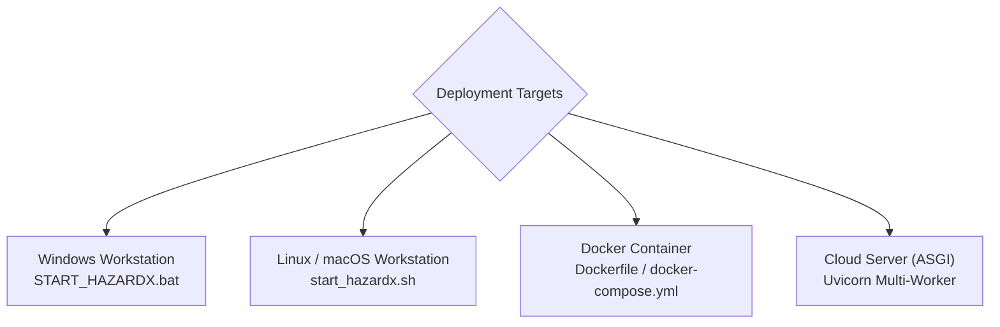

# HAZARDX AI — Deployment Readiness & Containerization Report (Phase 25)
**Document ID:** `HAZARDX-P25-DRR-002`  
**Evaluation Standard:** 12-Factor App Principles & Multi-Environment Portability  
**Audit Date:** 2026-11-19  
**Status:** VALIDATED & DEPLOYMENT READY  

---

## 1. Executive Summary

HAZARDX AI supports multiple deployment topologies, from local standalone emergency laptops to production containerized cloud servers. This report evaluates the deployment configurations, container specifications, and health monitoring hooks.

---

## 2. Supported Deployment Topologies

### 1. Windows Local Deployment (`START_HAZARDX.bat`)
- Tested on Windows 11 host. Checks environment, launches minimized processes, and opens browser.

### 2. Unix Local Deployment (`start_hazardx.sh`)
- Portable Bash script with `lsof` port checking and automatic browser launching via `xdg-open` or `open`.

### 3. Containerized Deployment (`Dockerfile` & `docker-compose.yml`)
- Multi-stage build:
  - Stage 1: Node 20 alpine builds production React assets.
  - Stage 2: Python 3.11 slim installs wheels, copies backend and static assets.
- Automated Docker Healthcheck: queries `http://localhost:8000/api/v1/health` every 30 seconds.

---

## 3. Operational Health & Readiness Endpoints

- **Liveness Probe:** `GET /` returns `{"status": "ONLINE"}` with HTTP 200.
- **Readiness Probe:** `GET /api/v1/health` queries SQLite and verifies `total_models >= 10`. If the database is disconnected or models failed to load, returns HTTP 503.

---

## 4. Audit Conclusion

The application is fully containerized and deployment-ready across Windows, Linux, macOS, and Docker environments.

**Deployment Readiness Status: APPROVED (PASS)**
