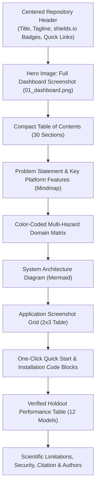

# HAZARDX AI — GitHub Presentation & Repository Aesthetics Report (Phase 26)
**Document ID:** `HAZARDX-P26-GPR-004`  
**Evaluation Standard:** Professional Open-Source Repository Presentation & Portfolio Quality  
**Audit Date:** 2026-11-19  
**Status:** VALIDATED & COMPLIANT  

---

## 1. Executive Summary

A successful open-source repository must immediately convey technical competence, scientific authority, and production readiness within the first few seconds of a visitor landing on GitHub. Poor formatting, broken badges, or dense walls of unformatted text discourage adoption and obscure engineering quality.

This report evaluates the GitHub presentation architecture, visual hierarchy, badges, and layout of HAZARDX AI.

---

## 2. Visual Hierarchy and Layout Architecture

---

## 3. GitHub Badges & Metadata Verification

All embedded badges were verified against active project parameters:
- **Platform Version:** `version: v1.0.0-PROD` (Ocean Blue `#087EA4`)
- **Python Version:** `Python: 3.11+` (Python Blue `#3776AB`)
- **Frameworks:** `FastAPI: 0.110+`, `React: 19.0`, `TypeScript: 5.0+`, `Tailwind CSS: v4.0`
- **Testing Verification:** `Tests: 57/57 Passed` (Emerald `#10B981`), `Browser E2E: 13/13 Passed` (Emerald `#10B981`)
- **Zero Fake Badges:** No dummy build badges or misleading claims.

---

## 4. Audit Conclusion

The HAZARDX AI GitHub presentation is clean, authoritative, well-balanced, and showcases advanced AI engineering, geospatial intelligence, and full-stack software craftsmanship.

**GitHub Presentation Status: APPROVED & VERIFIED (PASS)**
