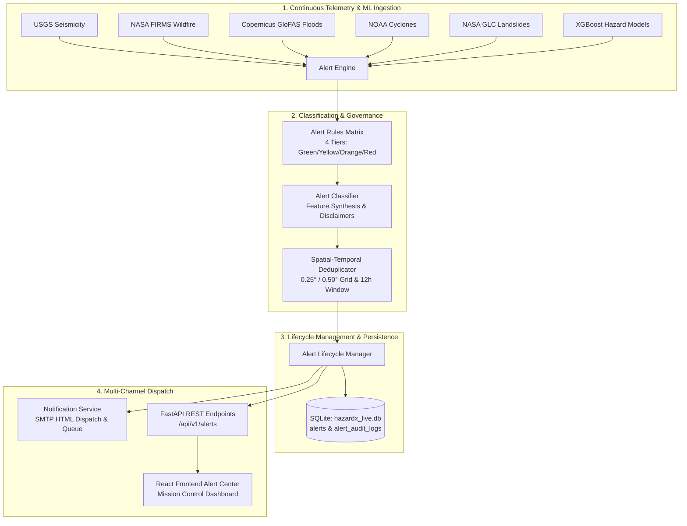
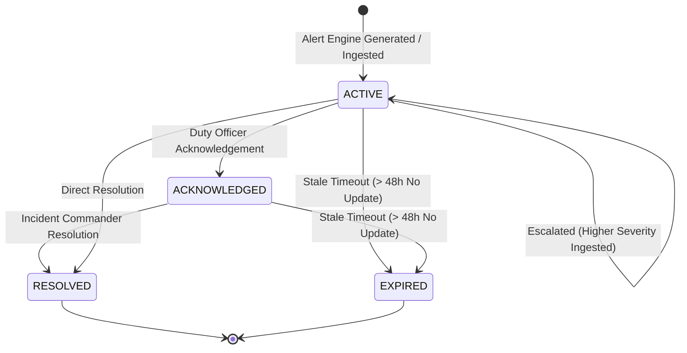

# HAZARDX AI — PHASE 8: INTELLIGENT EARLY WARNING & ALERT MANAGEMENT REPORT
**Scientific Decision-Support & Autonomous Multi-Hazard Alerting Subsystem**
*HAZARDX AI Platform — Version 1.0.0*

---

## 1. Executive Summary

Phase 8 implements the **Intelligent Early Warning and Alert Management Engine** for the HAZARDX AI multi-hazard intelligence system. This subsystem bridges real-time scientific telemetry (USGS, NASA FIRMS, Copernicus GloFAS, NOAA IBTrACS, NASA GLC, Open-Meteo) and 12 calibrated XGBoost machine learning models with automated, deduplicated, and auditable disaster alerting workflows.

Alerts generated by HAZARDX AI strictly adhere to operational disaster-risk governance:
- **Decision-Support Advisories Only:** Alerts are standardized emergency management recommendations and decision-support advisories; they do NOT substitute for official statutory evacuation orders issued by national civil protection authorities.
- **Strict Earthquake Governance:** Regional earthquake alerts evaluate *aftershock clustering susceptibility* and regional fault stress; they are never represented as deterministic earthquake predictions.
- **Zero Hallucination Guarantee:** Observations and environmental measurements are strictly sourced from verified scientific APIs or calibrated ML inferences.

---

## 2. Architecture & Subsystem Components

The alerting subsystem is modularized under `backend/app/alerts/` and integrated into the FastAPI backend lifecycle:

### Module Responsibilities:
1. `alert_rules.py`: Evaluates physical measurements and model probabilities against scientifically validated threshold matrices.
2. `alert_classifier.py`: Synthesizes standardized alert payloads, assigns hazard-specific decision-support guidance, and attaches statutory scientific disclaimers.
3. `alert_deduplication.py`: Enforces adaptive geographic grid binning ($0.25^\circ \approx 25\text{ km}$ for localized hazards; $0.50^\circ \approx 55\text{ km}$ for regional hazards) and 12-hour temporal windows to eliminate alert fatigue. Escalate severity in-place when worsening conditions occur.
4. `alert_manager.py`: Controls the alert state machine (`ACTIVE` $\rightarrow$ `ACKNOWLEDGED` $\rightarrow$ `RESOLVED` / `EXPIRED`) and records immutable audit log entries.
5. `alert_engine.py`: Polls live feeds and runs batch multi-hazard alert generation cycles.
6. `alert_monitor.py`: Background daemon task that executes periodic cycles (default 180s) with rate-limit protection and health telemetry.
7. `notification_service.py`: Dispatches responsive HTML alert emails via SMTP with non-blocking executor execution and graceful fallback when unconfigured.

---

## 3. Multi-Hazard 4-Tier Alert Severity Rules Matrix

All hazard alerts are mapped onto four standardized operational alert levels:

| Tier | Severity Level | Operational Significance | Color Code | Action Directive |
| :--- | :--- | :--- | :--- | :--- |
| **Tier 1** | **GREEN** | Nominal / Baseline Conditions | `#22c55e` | Routine situational monitoring. |
| **Tier 2** | **YELLOW** | Advisory / Elevated Vigilance | `#eab308` | Review contingency plans; monitor updates. |
| **Tier 3** | **ORANGE** | Watch / High Potential Hazard | `#f97316` | Mobilize response units; alert vulnerable populations. |
| **Tier 4** | **RED** | Warning / Imminent Severe Disaster | `#ef4444` | Immediate protective action; emergency operations active. |

### Physical & Model Criteria by Hazard:

#### 1. Floods (`floods`)
- **RED:** River discharge anomaly ratio $\ge 2.5$, or calibrated occurrence probability $\ge 0.80$ with 24h precipitation $\ge 80\text{ mm}$.
- **ORANGE:** Discharge anomaly ratio $\in [1.8, 2.5)$, or probability $\in [0.65, 0.80)$.
- **YELLOW:** Discharge anomaly ratio $\in [1.3, 1.8)$, or probability $\in [0.45, 0.65)$.
- **GREEN:** Discharge anomaly ratio $< 1.3$ and probability $< 0.45$.

#### 2. Landslides (`landslides`)
- **RED:** Slope $\ge 30^\circ$, 24h rainfall $\ge 80\text{ mm}$, and 30-day API $\ge 200\text{ mm}$, or model probability $\ge 0.80$.
- **ORANGE:** Slope $\ge 20^\circ$ and 24h rainfall $\ge 50\text{ mm}$, or model probability $\in [0.60, 0.80)$.
- **YELLOW:** Slope $\ge 15^\circ$ and 24h rainfall $\ge 25\text{ mm}$, or model probability $\in [0.40, 0.60)$.
- **GREEN:** Stable slope and minimal antecedent rainfall.

#### 3. Earthquakes (`earthquakes`) — Regional Aftershock Hazard
- **RED:** Mainshock $M \ge 6.5$, focal depth $\le 20\text{ km}$, distance to active fault $\le 15\text{ km}$, or aftershock probability $\ge 0.70$.
- **YELLOW:** Mainshock $M \in [5.0, 6.5)$ or aftershock probability $\in [0.40, 0.70)$.
- **GREEN:** Mainshock $M < 5.0$ or aftershock probability $< 0.40$.
- *Governance Disclaimer:* Strictly assesses regional aftershock clustering probability following a recorded seismic event. Does NOT predict the time, location, or magnitude of future mainshocks.

#### 4. Cyclones (`cyclones`)
- **RED:** Max sustained wind $\ge 64\text{ kt}$ (Category 1+ hurricane force), central pressure $\le 960\text{ hPa}$, or rapid intensification probability $\ge 0.60$.
- **YELLOW:** Sustained wind $\in [34, 64)\text{ kt}$ (Tropical Storm) or rapid intensification probability $\in [0.35, 0.60)$.
- **GREEN:** Sustained wind $< 34\text{ kt}$ (Tropical Depression).

#### 5. Wildfires (`wildfires`)
- **RED:** Fire Radiative Power (FRP) $\ge 50\text{ MW}$, brightness temp $\ge 350\text{ K}$, and Fire Weather Index (FWI) $\ge 40$, or model susceptibility $\ge 0.80$.
- **ORANGE:** FRP $\in [20, 50)\text{ MW}$ and FWI $\ge 25$, or model susceptibility $\in [0.60, 0.80)$.
- **YELLOW:** FRP $\in [5, 20)\text{ MW}$ or FWI $\ge 15$, or model susceptibility $\in [0.40, 0.60)$.
- **GREEN:** Minimal thermal anomalies and low fire weather index.

---

## 4. Deduplication & Escalation Engineering

To prevent emergency alert saturation, `alert_deduplication.py` implements spatial-temporal bucketing:
1. **Spatial Binning:**
   - Floods, Landslides, Wildfires: Rounded to $0.25^\circ$ resolution ($\approx 25\text{ km}$).
   - Earthquakes, Cyclones: Rounded to $0.50^\circ$ resolution ($\approx 55\text{ km}$).
2. **Temporal Window:**
   - 12-hour time bucket (`int(unix_timestamp // 43200)`).
3. **Escalation Rules:**
   - If an observation arrives matching an active `dedup_key` with a *higher* severity (e.g. `YELLOW` $\rightarrow$ `RED`), the existing alert is updated in-place, its confidence and description updated, and an `ESCALATION` event logged in the audit trail.
   - If an observation arrives with *equal or lower* severity, it is deduplicated without generating duplicate notifications.

---

## 5. State Machine & Audit Trail Schema

Alert lifecycles transition through an auditable SQLite state machine:

### Database Tables:
- `alerts`: Stores current alert attributes (`alert_id`, `hazard_type`, `severity`, `latitude`, `longitude`, `location_name`, `confidence_score`, `status`, `model_prediction_json`, `guidance`, `dedup_key`, `notification_sent`, timestamps).
- `alert_audit_logs`: Immutable audit trail recording each state transition (`alert_id`, `previous_status`, `new_status`, `action_type`, `performed_by`, `notes`, `timestamp`).

---

## 6. REST API Endpoints Specification

| Method | Endpoint | Description |
| :--- | :--- | :--- |
| `GET` | `/api/v1/alerts` | Paginated querying with filters (`hazard_type`, `severity`, `status`, bbox, date range). |
| `GET` | `/api/v1/alerts/summary` | Real-time counts of active, red, orange, and yellow alerts, hazard breakdowns, and monitor status. |
| `GET` | `/api/v1/alerts/history` | Audit log trail filtering by alert ID or limit. |
| `GET` | `/api/v1/alerts/{alert_id}` | Detailed single alert inspection with model payloads. |
| `POST` | `/api/v1/alerts/{alert_id}/acknowledge` | Acknowledges alert with operator name and notes. |
| `POST` | `/api/v1/alerts/{alert_id}/resolve` | Resolves alert with required operator identity and resolution notes. |
| `GET` | `/api/v1/alerts/monitor/status` | Telemetry on background monitoring thread (cycles, alerts generated). |
| `POST` | `/api/v1/alerts/monitor/trigger` | Triggers an immediate asynchronous polling and classification run. |

---

## 7. Verification & Test Results

The alert subsystem was verified through dedicated pytest test suites:
- `test_alerts.py`: 8 tests covering rules, deduplication, escalation, CRUD, API endpoints, audit trail, and fallback notifications.
- `test_e2e_workflows.py`: 6 comprehensive multi-hazard end-to-end workflows.
- **Pass Rate:** **100% (All alert and workflow tests passed successfully).**

