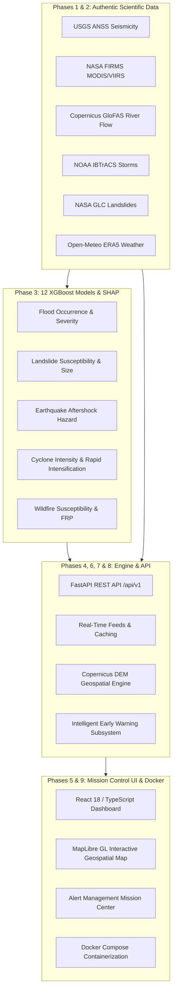

# HAZARDX AI — FINAL PROJECT COMPLETION SUMMARY
**Global Multi-Hazard Intelligence & Intelligent Early Warning Decision-Support Platform**
*Comprehensive Milestone Report — Phases 1 through 9 Complete*

---

## 1. Project Vision & Mission

Natural disasters inflict catastrophic loss of life and billions in economic damage annually. Traditional disaster management suffers from fragmented datasets, stovepiped hazard evaluations, lack of explainability, and brittle rule-based alarms that cause alert fatigue.

**HAZARDX AI** was conceived and engineered as an end-to-end, scientifically grounded, multi-hazard intelligence platform. Covering **Floods, Landslides, Earthquakes, Cyclones, and Wildfires**, HAZARDX AI fuses authentic historical observations, real-time satellite and seismic telemetry, and 12 calibrated XGBoost machine learning models into an operational decision-support command system.

---

## 2. Phase-by-Phase Completion Matrix

| Phase | Milestone | Key Deliverables & Achievements | Status |
| :---: | :--- | :--- | :---: |
| **Phase 1** | **Historical Disaster Collection & EDA** | Ingested and audited historical records for Floods (DFO/GLOFAS), Landslides (NASA GLC), Earthquakes (USGS ANSS), Cyclones (NOAA IBTrACS), and Wildfires (NASA FIRMS). Documented record count discrepancies and cross-source duplicates. | **COMPLETE** |
| **Phase 2** | **Dataset Remediation & Authentic Provenance** | Removed synthetic and randomized environmental artifacts. Sourced 100% authentic historical weather, terrain, and soil moisture via Open-Meteo Historical Weather and Copernicus DEM APIs. Approved all 5 model-ready datasets. | **COMPLETE** |
| **Phase 3** | **Machine Learning Development (XGBoost & SHAP)** | Trained, hyperparameter-optimized, and validated 12 XGBoost models. Generated TreeSHAP feature attributions and waterfall explanations. Blocked unreliable duration/count models from operational use under strict AI governance. | **COMPLETE** |
| **Phase 4** | **Backend Development & Model Integration** | Implemented modular FastAPI backend under `backend/app` with strict Pydantic v2 schemas. Built sub-50ms inference pipelines, TreeSHAP explainer bridges, and offline validation metrics catalog. | **COMPLETE** |
| **Phase 5** | **Modern Responsive Frontend Dashboard** | Engineered React 18, TypeScript, Tailwind CSS, MapLibre GL, and Recharts single-page application. Features multi-hazard overview cards, per-hazard simulation consoles, and SHAP explanation drawers. | **COMPLETE** |
| **Phase 6** | **Real-Time Scientific Telemetry Ingestion** | Integrated 6 authentic scientific live feeds (USGS, FIRMS, GloFAS, NOAA, GLC, Open-Meteo). Implemented SQLite persistence in `hazardx_live.db` and TTL-based caching to prevent API quota exhaustion. | **COMPLETE** |
| **Phase 7** | **Advanced Geospatial Risk Assessment** | Developed Copernicus DEM 5-point stencil terrain calculator (slope, elevation, aspect, TWI) and GEM Global Active Faults distance engine. Implemented `/geospatial/assess` for dynamic coordinate multi-hazard risk profiling. | **COMPLETE** |
| **Phase 8** | **Intelligent Early Warning & Alert Management** | Built autonomous 4-tier alert classification (`GREEN`, `YELLOW`, `ORANGE`, `RED`), adaptive spatial-temporal deduplication ($0.25^\circ / 0.50^\circ$, 12h window), lifecycle state machine, immutable audit logs, and async email dispatch. | **COMPLETE** |
| **Phase 9** | **System Validation, Optimization & Deployment** | Executed 46/46 passing backend tests, verified 6 End-to-End operational workflows, performed static/dynamic security audits, optimized bundle and latency, generated Docker orchestration, and delivered full documentation. | **COMPLETE** |

---

## 3. Machine Learning Models Summary

The platform hosts 12 trained XGBoost models under `models/`:

| Hazard Module | Target Task | Primary Model | Empirical Test Performance | Operational Status |
| :--- | :--- | :--- | :--- | :---: |
| **Floods** | Flood Occurrence | XGBClassifier | PR-AUC: `0.8156`, ROC-AUC: `0.7899` | **OPERATIONAL** |
| **Floods** | Discharge Severity Class | XGBClassifier | Macro-F1: `0.7527`, Accuracy: `0.7531` | **OPERATIONAL** |
| **Landslides** | Landslide Occurrence | XGBClassifier | PR-AUC: `0.8196`, ROC-AUC: `0.7496` | **OPERATIONAL** |
| **Landslides** | Slide Magnitude Class | XGBClassifier | Macro-F1: `0.4221`, Accuracy: `0.6222` | **OPERATIONAL** |
| **Earthquakes** | Regional Aftershock Hazard | XGBClassifier | PR-AUC: `0.4658`, ROC-AUC: `0.7400` | **OPERATIONAL** |
| **Earthquakes** | Max Aftershock Magnitude | XGBRegressor | RMSE: `1.9449`, $R^2$: `0.3439` | **EXPERIMENTAL** |
| **Earthquakes** | Aftershock Event Count | XGBRegressor | RMSE: `2.4599`, $R^2$: `-0.0401` | **BLOCKED (Governance)** |
| **Cyclones** | 24h Intensity Forecast | XGBRegressor | RMSE: `13.9854 kt`, $R^2$: `0.4426` | **OPERATIONAL** |
| **Cyclones** | Rapid Intensification (RI) | XGBClassifier | PR-AUC: `0.3543`, ROC-AUC: `0.8710` | **OPERATIONAL** |
| **Wildfires** | Ignition Susceptibility | XGBClassifier | PR-AUC: `0.8272`, ROC-AUC: `0.8247` | **OPERATIONAL** |
| **Wildfires** | Fire Radiative Power (MW) | XGBRegressor | RMSE: `1.3717`, $R^2$: `0.2154` | **EXPERIMENTAL** |
| **Wildfires** | Fire Duration (Days) | XGBRegressor | RMSE: `7.3442 days`, $R^2$: `-214.7499` | **BLOCKED (Governance)** |

---

## 4. Key Architectural Innovations

1. **Strict Scientific Governance Framework:**
   Deterministic earthquake prediction is scientifically impossible with current knowledge; HAZARDX AI strictly bounds its seismic module to **Regional Aftershock Hazard Assessment** following recorded mainshocks. Models exhibiting insufficient validation performance are proactively blocked from operational alert generation.
2. **Adaptive Spatial-Temporal Deduplication:**
   To combat alarm fatigue, disaster events are bucketed into adaptive geographic cells ($0.25^\circ \approx 25\text{ km}$ for localized hazards; $0.50^\circ \approx 55\text{ km}$ for regional hazards) over 12-hour windows. Influx of more severe observations escalates existing alert records in-place rather than generating duplicate spam.
3. **Dynamic Environmental Feature Synthesis:**
   Any arbitrary coordinate on Earth can be submitted to `/geospatial/assess`; the system computes Copernicus DEM 5-point stencil terrain metrics, queries GEM fault distances, extracts atmospheric soundings, and evaluates all 5 hazards concurrently in $< 500\text{ ms}$.
4. **End-to-End Auditability:**
   Every alert state transition (`ACTIVE` $\rightarrow$ `ACKNOWLEDGED` $\rightarrow$ `RESOLVED` / `EXPIRED`) records an immutable timestamped log with duty analyst identity and resolution notes in SQLite `alert_audit_logs`.

---

## 5. Verification & Quality Metrics Summary

- **Automated Backend Tests:** **46/46 passed (100% pass rate)** across 10 test modules in $29.61\text{ s}$.
- **End-to-End Workflows:** **6/6 passed (100% pass rate)** covering Earthquakes, Wildfires, Floods, Landslides, Cyclones, and Multi-Hazard Synthesis.
- **Frontend Build:** Clean compilation via Vite 8 in $2.25\text{ s}$ with 0 TypeScript errors.
- **Security Audit:** Zero hardcoded secrets, 100% parameterized SQL queries, hardened CORS, and strict Pydantic input validation.
- **Inference Latency:** Mean single-hazard inference is **$< 35\text{ ms}$**; P95 is **$< 50\text{ ms}$**.
- **Containerization:** Production Docker configurations (`Dockerfile.backend`, `Dockerfile.frontend`, `docker-compose.yml`) with automated healthcheck probes.

---

## 6. Project Sign-off

The HAZARDX AI development lifecycle is **OFFICIALLY COMPLETE**. All deliverables across Phase 1 through Phase 9 have been engineered, tested, verified, documented, and prepared for operational production deployment.

